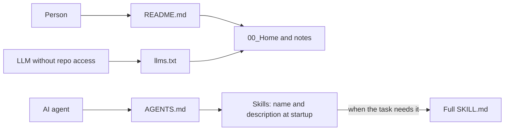

# Repository and documentation patterns for AI

> [!tldr] In 3 lines
> One rules file (`AGENTS.md`), short and written by hand. Every other agent file only points to it.
> The README tells people what the repository is and how to start; `llms.txt` indexes it for LLMs.
> Checks run on every push, and anything that is a prediction is marked as one.

## Study explanation

A repository now has two kinds of readers: people and AI agents. Both arrive with no memory of the project. A person opens the README. An agent reads a rules file. The problem this guide solves is drift. If the same rule is written in five places, the copies slowly disagree, and an agent follows a stale copy as faithfully as a fresh one.

The answer is to give each reader one entry point and to make every other file point to it. `AGENTS.md` holds the rules for any agent. It is an open standard, now under the Agentic AI Foundation [F2]. `CLAUDE.md` and `GEMINI.md` only import it, and the Copilot instructions file points to it, since Copilot uses both when both exist [F3]. The README is for people: what the project does, why it helps, how to start, where to get help and who maintains it [F1]. `llms.txt` is an index for a model that cannot browse the repository: a title, a short summary and lists of links [F4]. Skills sit apart, in `SKILL.md` files, and only their name and description load at startup [F5].

A worked example. Suppose you decide that file names must use underscores instead of spaces. The tempting move is to write the rule in the README, in `AGENTS.md`, in `CLAUDE.md` and in the Copilot file. Next month one copy says something slightly different. The better move is one line in `AGENTS.md`. The other agent files already point there, so nothing else changes. Then the rule gets a check that runs on every push, so it no longer depends on any agent reading it. Now ask what else belongs in `AGENTS.md`. The exact commands to run the checks belong there, because an agent cannot guess them. A paragraph on why the project exists does not, because the README already says it.

That last point has research behind it. Gloaguen and colleagues (ICLR 2026) measured three coding agents and found that human-written context files gave about a 4% average gain, while LLM-generated ones had a slightly negative effect and raised cost by more than 20% [F6]. Agents follow instructions, so an unnecessary requirement becomes extra work.

The most common mistake is to ask an AI to write a long `AGENTS.md` from the repository and commit it unedited. It repeats the README, adds requirements nobody needs and costs more to run. A second mistake is mixing kinds of documentation on one page. Diátaxis names four kinds: tutorial, how-to guide, reference and explanation, and the classic failure is to blend them [F7].

This guide connects to two other notes. [[Studying_with_AI|Studying with AI]] makes the same argument from the learner's side: the assistant should do the part that does not teach, and leave the effort to you. [[How_to_Study_with_this_Vault|How to study with this vault]] is the human-facing method that the rules file tells agents to follow.

## Key takeaways

- **Remember:** one source of rules, short and hand-written. Every other agent file points to it. README for people, `AGENTS.md` for agents, `llms.txt` as an index.
- **Common confusion:** a longer instructions file is not a better one. The gains come from exact commands and checks, not from more text.
- **Exercise:** list every file in a repository you know that holds rules for agents. For each rule, decide which single file should own it and which copies to turn into pointers.

## 1. The files in this repository and why

| File | Purpose |
|---|---|
| `README.md` | Human entry point: what it does, why it helps, how to start, where to get help, who maintains it [F1] |
| `AGENTS.md` | Rules for any agent. An open standard, now under the Agentic AI Foundation (Linux Foundation) [F2] |
| `CLAUDE.md`, `GEMINI.md` | Only import `@AGENTS.md`. Copilot also accepts both at the root [F3] |
| `.github/copilot-instructions.md` | Copilot's repository-wide instructions. When `AGENTS.md` also exists, Copilot uses both [F3] |
| `.github/instructions/*.instructions.md` | Path-specific rules with an `applyTo` glob [F3]; add them only when one folder needs different rules |
| `llms.txt` | Curated index for LLMs: required H1, a blockquote summary, link lists under H2, an "Optional" section [F4] |
| `.agents/skills/*/SKILL.md` | Skills in the open Agent Skills format: only name and description load at startup [F5] |
| `.gitattributes`, `.editorconfig` | LF line endings, binaries marked, UTF-8 |
| `.github/workflows/checks.yml` | Formatting, links, study layer, names and tests on every push |

In a public template, `CONTRIBUTING.md`, `CODEOWNERS`, issue templates and `SECURITY.md` tell visitors how to help, who reviews and where to report a problem. A private notes vault can leave them out.

## 2. What research says about context files

- **Hand-written helps a little; LLM-generated hurts.** Gloaguen et al. (ICLR 2026) measured Claude Code, Codex and Qwen Code: human-written context files gave about 4% average gain; LLM-generated ones had a slightly negative effect and cost rose by more than 20% [F6].
- **Why.** Agents follow instructions. An unnecessary requirement becomes extra work. Content that repeats the README adds nothing [F6].
- **Rule of thumb.** Only what the agent cannot discover alone: exact commands, what never to do, where things are. Do not repeat the README.

## 3. Content and writing patterns

- **README (GitHub):** what it does, why it helps, how to start, where to get help, who maintains it. Long details go elsewhere. Relative links. GitHub truncates READMEs above 500 KiB and builds the outline on its own [F1].
- **Diátaxis:** four document types, one per need: tutorial (learn by doing), how-to guide (steps for a task), reference (look things up) and explanation (the why). The classic mistake is mixing types on one page [F7]. In this vault: concept notes are explanation, guides are how-to, `40_References` and `AGENTS.md` are reference.
- **Writing:** short sentences, active voice, second person, one term per thing, no em dash.

## 4. Trends from 2027 on

| Trend | Status | Confidence |
|---|---|---|
| `AGENTS.md` as the single cross-tool standard | Confirmed: a founding project of the Agentic AI Foundation, next to MCP and goose (Dec. 2025) [F2] | high |
| Portable skills (`SKILL.md`) | Confirmed: open standard since Dec. 2025, adopted by dozens of tools [F5] | medium (counts vary by source) |
| Agents and prompts versioned in the repo (`.github/agents/*.agent.md`, `.github/prompts/*.prompt.md`) | Confirmed in secondary sources; check the official docs before use [F8] | medium |
| Less context text, more automatic checks | Prediction supported by [F6]: gains come from commands and tests, not long instructions | medium |
| `llms.txt` as a standard index | Stable format; real adoption by models not yet measured | low |

## Related

- [[Studying_with_AI|Studying with AI]]
- [[Retrieval_Practice|Retrieval practice]]

## Flashcards

Where do an agent's rules live in this repository?::In `AGENTS.md`. `CLAUDE.md` and `GEMINI.md` only import it.
What belongs in an agent rules file?::Only what the agent cannot discover alone: exact commands, what never to do, where things are.
What did Gloaguen et al. (ICLR 2026) find about LLM-generated context files?::A slightly negative effect and cost up by more than 20%; human-written files gave about a 4% gain.
What does `llms.txt` hold?::A required H1, a blockquote summary, link lists under H2 headings and an "Optional" section.
What are the four Diátaxis document types?::Tutorial, how-to guide, reference and explanation.
Which parts of a skill load at startup?::Only its name and description.
A skill loads its full `SKILL.md` ==when the task needs it==.

## Sources

- [F1] GitHub Docs, About READMEs: https://docs.github.com/en/repositories/managing-your-repositorys-settings-and-features/customizing-your-repository/about-readmes
- [F2] Linux Foundation, Agentic AI Foundation (coverage): https://www.privacyguides.org/news/2025/12/24/the-linux-foundation-announces-formation-of-the-agentic-ai-foundation/
- [F3] GitHub Docs, custom instructions: https://docs.github.com/en/copilot/concepts/prompting-and-context/custom-instructions and https://docs.github.com/en/copilot/how-tos/copilot-cli/customize-copilot/add-custom-instructions
- [F4] llms.txt: https://llmstxt.org/
- [F5] Agent Skills (coverage): https://strapi.io/blog/what-are-agent-skills-and-how-to-use-them
- [F6] Gloaguen et al., Evaluating AGENTS.md, arXiv:2602.11988: https://arxiv.org/abs/2602.11988
- [F7] Diátaxis (Canonical): https://ubuntu.com/blog/diataxis-a-new-foundation-for-canonical-documentation
- [F8] Copilot CLI custom agents (secondary source): https://www.devleader.ca/2026/07/23/github-copilot-cli-custom-agents-and-skills
