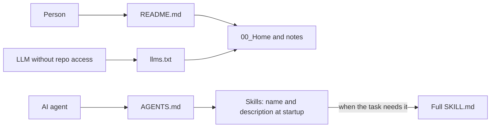

# Repository and documentation patterns for AI

> [!tldr] In short
> One rules file (`AGENTS.md`), short and written by hand. The other agent files only point to it. The README says what the repository is, how to start and where everything else is. Checks run on every push. Anything that is a prediction is marked as one.

## 1. The files in this repository and why

| File | Purpose |
|---|---|
| `README.md` | Human entry point: what it does, why it helps, how to start, where to get help, who maintains it [F1] |
| `AGENTS.md` | Rules for any agent. An open standard, now under the Agentic AI Foundation (Linux Foundation) [F2] |
| `CLAUDE.md`, `GEMINI.md` | Only import `@AGENTS.md`. Copilot also accepts both at the root [F3] |
| `.github/copilot-instructions.md` | Copilot's repository-wide instructions. When `AGENTS.md` also exists, Copilot uses both [F3] |
| `.github/instructions/*.instructions.md` | Path-specific rules with an `applyTo` glob [F3]; add them only when one folder needs different rules |
| `llms.txt` | Curated index for LLMs: required H1, a blockquote summary, link lists under H2, an "Optional" section [F4] |
| `.agents/skills/*/SKILL.md` | Skills in the open Agent Skills format: only name and description load at startup [F5] |
| `.gitattributes`, `.editorconfig` | LF line endings, binaries marked, UTF-8 |
| `.github/workflows/checks.yml` | Formatting, links, study layer, names and tests on every push |

For a personal or small repository, `CONTRIBUTING`, `CODEOWNERS`, issue templates and `SECURITY.md` are usually overkill.

## 2. What research says about context files

- **Hand-written helps a little; LLM-generated hurts.** Gloaguen et al. (ICLR 2026) measured Claude Code, Codex and Qwen Code: human-written context files gave about 4% average gain; LLM-generated ones had a slightly negative effect and cost rose by more than 20% [F6].
- **Why.** Agents follow instructions. An unnecessary requirement becomes extra work. Content that repeats the README adds nothing [F6].
- **Rule of thumb.** Only what the agent cannot discover alone: exact commands, what never to do, where things are. Do not repeat the README.

## 3. Content and writing patterns

- **README (GitHub):** what it does, why it helps, how to start, where to get help, who maintains it. Long details go elsewhere. Relative links. GitHub truncates READMEs above 500 KiB and builds the outline on its own [F1].
- **Diátaxis:** four document types, one per need: tutorial (learn by doing), how-to guide (steps for a task), reference (look things up) and explanation (the why). The classic mistake is mixing types on one page [F7]. In this vault: concept notes are explanation, guides are how-to, `40_References` and `AGENTS.md` are reference.
- **Writing:** short sentences, active voice, second person, one term per thing, no em dash.

## 4. Trends from 2027 on

| Trend | Status | Confidence |
|---|---|---|
| `AGENTS.md` as the single cross-tool standard | Confirmed: a founding project of the Agentic AI Foundation, next to MCP and goose (Dec. 2025) [F2] | high |
| Portable skills (`SKILL.md`) | Confirmed: open standard since Dec. 2025, adopted by dozens of tools [F5] | medium (counts vary by source) |
| Agents and prompts versioned in the repo (`.github/agents/*.agent.md`, `.github/prompts/*.prompt.md`) | Confirmed in secondary sources; check the official docs before use [F8] | medium |
| Less context text, more automatic checks | Prediction supported by [F6]: gains come from commands and tests, not long instructions | medium |
| `llms.txt` as a standard index | Stable format; real adoption by models not yet measured | low |

## 5. Key takeaways

- One source of rules. Every other agent file points to it.
- Short and hand-written beats long and generated.
- README for people, `AGENTS.md` for agents, `llms.txt` as an index.

## Sources

- [F1] GitHub Docs, About READMEs: https://docs.github.com/en/repositories/managing-your-repositorys-settings-and-features/customizing-your-repository/about-readmes
- [F2] Linux Foundation, Agentic AI Foundation (coverage): https://www.privacyguides.org/news/2025/12/24/the-linux-foundation-announces-formation-of-the-agentic-ai-foundation/
- [F3] GitHub Docs, custom instructions: https://docs.github.com/en/copilot/concepts/prompting-and-context/custom-instructions and https://docs.github.com/en/copilot/how-tos/copilot-cli/customize-copilot/add-custom-instructions
- [F4] llms.txt: https://llmstxt.org/
- [F5] Agent Skills (coverage): https://strapi.io/blog/what-are-agent-skills-and-how-to-use-them
- [F6] Gloaguen et al., Evaluating AGENTS.md, arXiv:2602.11988: https://arxiv.org/abs/2602.11988
- [F7] Diátaxis (Canonical): https://ubuntu.com/blog/diataxis-a-new-foundation-for-canonical-documentation
- [F8] Copilot CLI custom agents (secondary source): https://www.devleader.ca/2026/07/23/github-copilot-cli-custom-agents-and-skills
