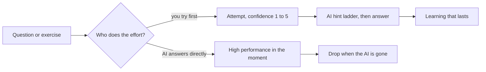
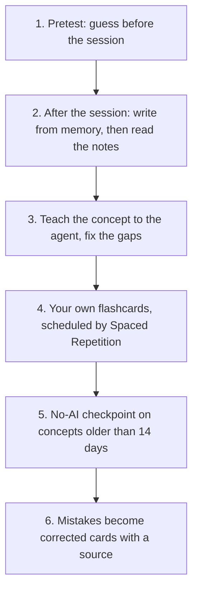

# Studying with AI

> [!tldr] In 3 lines
> What makes learning stick has not changed: pull from memory (test yourself), space your reviews, and do the effortful part yourself.
> AI helps when it acts as a tutor that asks and hints, and hurts when it hands over the answer: with an unrestricted chatbot, students practiced better and scored 17% worse on the exam without it.
> Rule of thumb: the AI asks, hints and corrects; you recall, solve and explain.

## Study explanation

Learning is not putting information into your head. It is being able to get it out when you need it. That is why the techniques that work train the output, not the input.

The strongest is retrieval practice: trying to recall before looking. Roediger and Karpicke (2006) had students reread passages or write down what they remembered. Five minutes later rereaders did better (83% against 71%). One week later the order flipped: 61% for those who tested themselves, 40% for rereaders [F1]. Rereading feels like mastery because the text looks familiar. Remembering requires having pulled it out before. Quizzing also works in real classrooms [F11], and its benefit carries over to new questions, not only the ones you practiced [F12]. So write cards that ask you to use an idea, not only to recite it.

The second is spacing: reviewing on different days beats reviewing at once, and the best gap grows with how long you need to remember [F2][F3]. Dunlosky and colleagues (2013) rated ten techniques and gave the top utility to only two: practice testing and distributed practice. Highlighting, rereading and summarizing rated low [F4]. Bjork calls what feels harder now and pays off later desirable difficulties.

Now the AI. It can work with these techniques or against them, and the difference is who does the effort. Bastani and colleagues (PNAS, 2025) followed about a thousand high school math students. One group used GPT-4 freely, another used a tutor version that gave hints, not answers. On practice problems both beat the no-AI group. On the exam without AI, the free group scored 17% below the no-AI group, and the tutor group tied it [F5]. Other work points the same way. In a randomized trial, students who studied with ChatGPT retained less on a surprise test weeks later [F13]. Learners who let the AI do the thinking improved their essays but not their knowledge, which the authors call metacognitive laziness [F14]. Lehmann and colleagues found no overall effect of LLMs in two lab experiments, but the effect depended on use: substituting for your own work reduced understanding of each topic, while asking for explanations did not [F15]. The positive case is Kestin and colleagues (2025): with the same 194 physics students, an AI tutor built on good practice (questions, small steps, no handed-out solution) beat an active-learning class, with more than twice the gain in less time [F6].

A second risk is false confidence. Steyvers and colleagues (2025) found that people trust an LLM answer more when the explanation is longer, even when it is no more accurate [F16]. A fluent answer feels like understanding. That is why this protocol asks you to rate your confidence from 1 to 5 before any reveal, and compare it with the result.

Tutor mode puts this into rules. You attempt first. The AI replies only after an attempt, with a hint ladder: a hint, then a strong hint, then a partial example, then the answer. You rate confidence before the reveal. The AI never writes your study layer or your answers. Self-explanation, where you explain an idea in your own words and an expert points out the gaps, has solid support [F17]. Mixed practice across topics (interleaving) helps most when the categories look alike, and less in other materials [F18]. Pretesting, a few questions before the session that you guess first, has a meta-analysis of its own, on the prequestion effect [F19].

A worked example. You studied Retrieval practice three weeks ago. You run a no-AI checkpoint. The agent asks, "A friend rereads their notes three times and feels ready. What do you tell them?" You write your answer, then rate confidence 4. The agent reveals the note's answer. You missed the part about delay, so your score is 60 and your confidence was higher than it deserved. The property `last_tested` is set and the miss goes to the mistakes file as a corrected card with its source.

The most common mistake is to ask the AI for an explanation first and call that studying. It feels efficient because the answer is clear. The clarity is the AI's, not yours.

## Key takeaways

- **Remember:** testing yourself and spacing have the most evidence. In tutor mode you try first, the AI hints in steps, and you rate confidence before any reveal.
- **Common confusion:** "I did better on the exercises with AI" does not mean "I learned more". Bastani showed the opposite. "AI tutors work" (Kestin) applies to tutors designed with these practices, not to an open chat.
- **Exercise:** pick a concept older than 14 days. Without looking, write 5 lines about it and rate your confidence. Then check the note and compare.

## Techniques: what the evidence says

| Technique | Evidence | How AI can help | How AI can hurt |
|---|---|---|---|
| Practice testing | high utility [F4]; classroom quizzing works [F11]; transfers to new questions [F12] | generates questions after you try | answers before you try |
| Spacing | high utility [F4] | schedules reviews | cramming the night before |
| Interleaving | moderate [F4]; helps most for similar categories [F18] | mixes topics in one review | easy single-type drills |
| Self-explanation | moderate [F4]; reliable gain [F17] | lists the gaps in your explanation | explains for you |
| Pretesting | meta-analysis of the prequestion effect [F19] | writes the prequestions | gives the answers first |
| Summarizing | low [F4] | organizes after you summarized | summarizes instead of you |
| Rereading, highlighting | low [F4] | nothing to add | false sense of mastery |

## AI in learning: what the studies show

| Study | Design | Finding | Limit |
|---|---|---|---|
| Bastani et al., PNAS 2025 [F5] | ~1,000 students, math, Turkey | GPT Base: +48% practice, -17% exam without AI; GPT Tutor: +127% and a tie | one school, one subject |
| Barcaui, 2025 [F13] | randomized trial, university students | ChatGPT users retained less on a delayed surprise test | one study; numbers not checked here |
| Fan et al., 2024 [F14] | lab study, essay task | better essays, no gain in knowledge or transfer | short task |
| Lehmann et al., 2024 [F15] | two lab experiments and a field study | no overall effect; substitute use lowers depth, complement use does not | effect depends on usage |
| Steyvers et al., 2025 [F16] | user studies on LLM answers | longer explanations raise trust, not accuracy | calibration, not learning |
| Kestin et al., Sci. Reports 2025 [F6] | 194 physics students, Harvard, crossover | AI tutor: more than twice the gain in less time | two topics, short term |
| Kosmyna et al., arXiv 2025 [F7] | 54 people, EEG, essays | weakest connectivity and recall with an LLM | preprint, one task |
| Lee et al., CHI 2025 [F8] | 319 workers, 936 examples | more trust in AI, less critical thinking | self-reported |

## Tutor mode protocol

Every skill and agent in this vault follows these rules.

1. **You attempt first.** Write an answer, a guess or a plan before the AI says anything about the content.
2. **Hint ladder, only after an attempt.** Hint, strong hint, partial example, answer. Do not skip steps.
3. **Confidence before reveal.** Rate 1 (guess) to 5 (certain). The gap between confidence and result is what to study.
4. **The AI never writes your study layer or your answers.** It does not fill `## Study explanation`, `## Key takeaways`, your flashcards or your guesses.
5. **Every claim has a source.** Cards link to the note they came from; unchecked material says "not verified".

| Skill | When | What you do | What the AI does |
|---|---|---|---|
| `pretest` | before a session | guess 3 to 5 questions | writes the questions |
| `no-ai-checkpoint` | concepts older than 14 days | predict your score, then answer closed book | grades, logs `last_tested` and `score` |
| `teach-the-agent` | after learning a concept | explain it in your words | lists only the gaps |
| `mistake-review` | when `50_Review/Mistakes.md` has entries | write the correction | checks the source, drafts the card |
| `review-queue` | start of a session | choose what to study | lists the weakest and oldest concepts |

The 14-day default is a rule of thumb: long enough that recall takes effort. It is not a research result. The bases `Weakest` and `Interleave` on the Home page show the same queue.

## Choosing the scheduler: FSRS

The Spaced Repetition plugin offers FSRS as an opt-in algorithm since version 1.15.0. FSRS is a model of memory that predicts when you will forget a card [F20]. Anki has offered it since 23.10 [F10].

1. Back up first. Copy the vault folder (or commit it) and copy the plugin's `data.json` by hand. Agents never read that file.
2. Update the plugin to 1.15.0 or later in Settings, Community plugins.
3. Open the plugin settings and pick FSRS in the scheduling algorithm option. The label can differ by version.
4. Review as usual. If the schedule feels wrong, restore the backup.

The FSRS benchmark compares how well algorithms predict whether you will recall a card [F10]. It measures prediction, not learning. A better prediction means better timing of reviews, not proof that you learn more. The default scheduler is fine. Switch if you review daily and want fewer, better-timed reviews.

## Trends from 2027 on

| Trend | Status | Confidence |
|---|---|---|
| Study modes in assistants (guide instead of answer) | Confirmed: ChatGPT, Gemini and Claude launched them in 2025 [F9] | high |
| More accurate spacing algorithms (FSRS) | Confirmed: Anki offers FSRS since version 23.10, the plugin since 1.15.0 [F10] | high |
| AI tutors designed with learning science | Strong early evidence [F6], few contexts so far | medium |
| Concern about dependence and "cognitive debt" | Signals in small studies and preprints [F7][F8][F13][F14] | medium |
| Assessment without AI regaining weight | Prediction, following from [F5] | low |

## Flashcards

Source: [[Retrieval_Practice|Retrieval practice]], [[Test-Enhanced_Learning_(Roediger_and_Karpicke,_2006)|Roediger and Karpicke]] and the Sources list below.

#flashcards

Which technique beat rereading in Roediger and Karpicke (2006)?::Testing yourself: after one week, 61% against 40%.
What happened to GPT Base users on the exam without AI in Bastani et al. (2025)?::They scored 17% below the no-AI group, despite doing better on practice.
What is the difference between GPT Base and GPT Tutor?::The Tutor gave hints, not answers; it tied the no-AI group on the exam.
In tutor mode, what happens before the AI says anything about the content?::You attempt: you write an answer, a guess or a plan.
What is the hint ladder, in order?::Hint, strong hint, partial example, answer, and only after an attempt.
Why rate your confidence from 1 to 5 before the reveal?::Fluent answers feel like understanding; the gap between confidence and result shows what to study.
Does a better FSRS benchmark score prove you learn more?::No. It measures how well the algorithm predicts recall, not learning.
Tutor mode says the AI never writes your ==study layer== or your answers.

## Not verified

- The full text of Bastani (PNAS) was read in its open copy on PubMed Central: about 1,000 students in grades 9 to 11 at one school in Turkey, GPT Base +48% in practice and -17% on the exam without AI, GPT Tutor +127% in practice and statistically indistinguishable from control on the exam; the authors note one school, one subject, Fall 2023 and short-term outcomes.
- The full texts of Kestin (Scientific Reports), Barcaui, Fan, Lehmann and Steyvers were not read; findings come from abstracts and publisher pages. Their numbers should be checked before reuse.
- The size of the pretesting benefit, the Barcaui retention numbers and the exact settings label for FSRS in the plugin were not checked.
- Widely shared numbers from the MIT study (such as "83% could not quote their own essay") appear only in blogs and were left out.
- The launch date of Claude's learning mode differs between sources (April or August 2025).
- The 14-day checkpoint interval is a design choice for this vault, not a measured optimum.

## Sources

- [F1] Roediger, H. L., & Karpicke, J. D. (2006). Test-enhanced learning. *Psychological Science*, 17(3). doi:10.1111/j.1467-9280.2006.01693.x
- [F2] Cepeda, N. J., Pashler, H., Vul, E., Wixted, J. T., & Rohrer, D. (2006). Distributed practice in verbal recall tasks. *Psychological Bulletin*, 132(3), 354-380. https://pubmed.ncbi.nlm.nih.gov/16719566/
- [F3] Cepeda, N. J., et al. (2008). Spacing effects in learning: a temporal ridgeline of optimal retention. *Psychological Science*, 19(11), 1095-1102. https://pubmed.ncbi.nlm.nih.gov/19076480/
- [F4] Dunlosky, J., Rawson, K., Marsh, E., Nathan, M. J., & Willingham, D. (2013). Improving students' learning with effective learning techniques. *Psychological Science in the Public Interest*, 14, 4-58. https://www.sciencedaily.com/releases/2013/01/130110111734.htm
- [F5] Bastani, H., et al. (2025). Generative AI without guardrails can harm learning: evidence from high school mathematics. *PNAS*, 122(26), e2422633122. doi:10.1073/pnas.2422633122. Open copy: https://pmc.ncbi.nlm.nih.gov/articles/PMC12232635/
- [F6] Kestin, G., Miller, K., Klales, A., Milbourne, T., & Ponti, G. (2025). AI tutoring outperforms in-class active learning. *Scientific Reports*, 15, 17458. https://pmc.ncbi.nlm.nih.gov/articles/PMC12179260/
- [F7] Kosmyna, N., et al. (2025). Your Brain on ChatGPT. arXiv:2506.08872. https://arxiv.org/abs/2506.08872
- [F8] Lee, H.-P., Sarkar, A., et al. (2025). The impact of generative AI on critical thinking. CHI '25. https://advait.org/files/lee_2025_ai_critical_thinking_survey.pdf
- [F9] TechCrunch (2025-08-06), Google's Guided Learning after ChatGPT's Study Mode: https://techcrunch.com/2025/08/06/google-takes-on-chatgpts-study-mode-with-new-guided-learning-tool-in-gemini/
- [F10] Anki Manual, spaced repetition algorithm: https://docs.ankiweb.net/faqs/what-spaced-repetition-algorithm ; FSRS benchmark: https://expertium.github.io/Benchmark.html
- [F11] Yang, C., Luo, L., Vadillo, M. A., Yu, R., & Shanks, D. R. (2021). Testing (quizzing) boosts classroom learning: a systematic and meta-analytic review. *Psychological Bulletin*. doi:10.1037/bul0000309
- [F12] Pan, S. C., & Rickard, T. C. (2018). Transfer of test-enhanced learning: meta-analytic review and synthesis. *Psychological Bulletin*. doi:10.1037/bul0000151
- [F13] Barcaui, A. (2025). ChatGPT as a cognitive crutch: evidence from a randomized controlled trial on knowledge retention. *Social Sciences & Humanities Open*. doi:10.1016/j.ssaho.2025.102287
- [F14] Fan, Y., et al. (2024). Beware of metacognitive laziness: effects of generative artificial intelligence on learning motivation, processes, and performance. arXiv:2412.09315. https://arxiv.org/abs/2412.09315
- [F15] Lehmann, M., Cornelius, P. B., & Sting, F. J. (2024). AI meets the classroom: when do large language models harm learning? arXiv:2409.09047. https://arxiv.org/abs/2409.09047
- [F16] Steyvers, M., et al. (2025). What large language models know and what people think they know. *Nature Machine Intelligence*. doi:10.1038/s42256-024-00976-7
- [F17] Bisra, K., Liu, Q., Nesbit, J. C., Salimi, F., & Winne, P. H. (2018). Inducing self-explanation: a meta-analysis. *Educational Psychology Review*. doi:10.1007/s10648-018-9434-x
- [F18] Brunmair, M., & Richter, T. (2019). Similarity matters: a meta-analysis of interleaved learning and its moderators. *Psychological Bulletin*. doi:10.1037/bul0000209
- [F19] St. Hilaire, K. J., Chan, J. C. K., & Ahn, D. (2023). Guessing as a learning intervention: a meta-analytic review of the prequestion effect. *Psychonomic Bulletin & Review*. doi:10.3758/s13423-023-02353-8
- [F20] Ye, J., Su, J., & Cao, Y. (2022). A stochastic shortest path algorithm for optimizing spaced repetition scheduling. *KDD '22*. doi:10.1145/3534678.3539081
