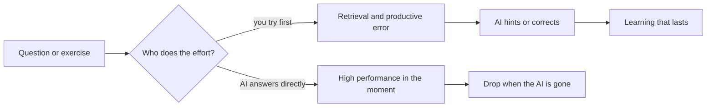
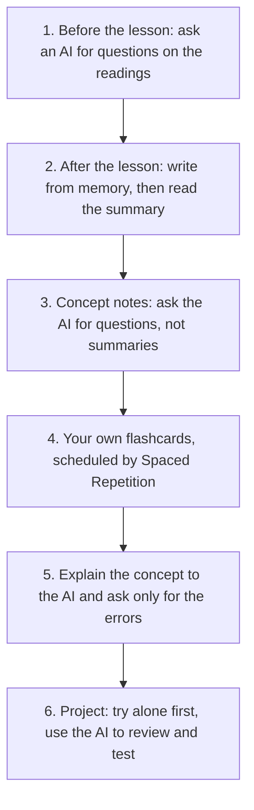

# Studying with AI

> [!tldr] In 3 lines
> What makes learning stick has not changed: pull from memory (test yourself), space your reviews, and do the effortful part yourself. Rereading and highlighting do little.
> AI helps when it acts as a tutor that asks and hints, and hurts when it hands over the answer: with an unrestricted chatbot, students practiced better and scored 17% worse on the exam without it.
> Rule of thumb: the AI asks, hints and corrects; you recall, solve and explain.

## Study explanation

Learning is not putting information into your head. It is being able to **get it out** when you need it. That is why the techniques that work train the output, not the input.

The strongest is **retrieval practice**: trying to recall before looking. Roediger and Karpicke (2006) had students either reread passages or write down what they remembered. Five minutes later, rereaders did better (83% vs 71%). One week later the order flipped: 61% for those who tested themselves, 40% for rereaders [F1]. Rereading feels like mastery because the text looks familiar. Remembering requires having pulled it out before.

The second is **spacing**. Reviewing the same material on different days beats reviewing it all at once. Cepeda and colleagues (2006) combined 839 comparisons from 317 experiments and showed that the best gap grows with how long you need to remember [F2]. In 2008 they measured it: for a test one week away, the best gap is 20% to 40% of that time; for a test a year away, 5% to 10% [F3]. In practice: short reviews at first, then wider apart. The Spaced Repetition plugin does this with your flashcards.

Dunlosky and colleagues (2013) rated ten techniques students use. Only two got the top utility rating: **practice testing** and **distributed practice**. Highlighting, rereading and summarizing got a low rating, not because they are useless, but because they do not help consistently [F4]. Bjork called this pattern **desirable difficulties**: what feels harder in the moment (recalling without looking, mixing problem types, spacing) tends to pay off later.

Now the AI. It can work with these techniques or against them, and the difference is **who does the effort**.

The clearest study is Bastani and colleagues (PNAS, 2025), with about a thousand high school math students in Turkey. One group used GPT-4 freely (GPT Base). Another used a version set up as a tutor that gave hints, not answers (GPT Tutor). On practice problems both beat the no-AI group: 48% and 127% better. On the exam without AI, GPT Base scored **17% below** the no-AI group. GPT Tutor tied [F5]. The authors' reading: students with ready answers leaned on them and did not learn the concept.

The positive side comes from Harvard. Kestin and colleagues (Scientific Reports, 2025) compared, with the same 194 physics students, an active-learning class with an AI tutor built on the same good practices: questions, small steps, no handed-out solution. With the tutor, students learned **more than twice as much in less time** and reported more engagement [F6]. The authors note it covered two topics and short-term tests.

There are also signs of cognitive cost. An MIT study (Kosmyna and colleagues, 2025, a preprint not yet peer reviewed) measured brain activity in 54 people writing essays with ChatGPT, with a search engine, or with nothing. The ChatGPT group showed the weakest brain connectivity, remembered least of what it wrote, and felt the text was less its own [F7]. Lee and colleagues (Microsoft and CMU, CHI 2025) surveyed 319 knowledge workers: more confidence in the AI went with less critical thinking; more self-confidence went with more. The mental work shifts from producing to checking and integrating [F8].

Putting it together: AI is great at **asking questions, giving hints, correcting explanations and organizing material**. It is bad when it does for you the part that teaches: recalling, solving and explaining. The vendors reacted: OpenAI launched Study Mode in July 2025, Google launched Guided Learning in Gemini a week later, and Anthropic has a learning mode in Claude. All try to guide instead of answer [F9].

## Key takeaways

- **Remember:** testing yourself and spacing are the two techniques with the most evidence. AI helps when it asks and hurts when it answers for you.
- **Common confusion:** "I did better on the exercises with AI" does not mean "I learned more". Bastani showed the opposite. And "AI tutors work" (Kestin) applies to tutors designed with good practices, not to an open chat.
- **Exercise:** pick a concept note. Without looking, write 5 lines about it. Then ask an AI: "ask me 5 questions about this text and tell me what I got wrong, without rewriting it". Compare with the note.

## Techniques: what the evidence says

| Technique | Utility (Dunlosky 2013) | How AI can help | How AI can hurt |
|---|---|---|---|
| Practice testing | high | generates questions and quizzes | answers before you try |
| Spacing | high | schedules and reminds reviews | cramming the night before |
| Interleaving | moderate | mixes problems from different topics | easy single-type drills |
| Self-explanation, elaboration | moderate | listens and points out gaps | explains for you |
| Summarizing | low | organizes after you summarized | summarizes instead of you |
| Rereading, highlighting | low | nothing to add | false sense of mastery |

## AI in learning: what the studies show

| Study | Design | Finding | Limit |
|---|---|---|---|
| Bastani et al., PNAS 2025 [F5] | ~1,000 students, math, Turkey | GPT Base: +48% practice, −17% exam without AI; GPT Tutor: +127% and a tie | one school, one subject |
| Kestin et al., Sci. Reports 2025 [F6] | 194 physics students, Harvard, crossover | AI tutor: more than twice the gain in less time | two topics, short term |
| Kosmyna et al., arXiv 2025 [F7] | 54 people, EEG, essays | weakest connectivity and recall with an LLM | preprint, one task |
| Lee et al., CHI 2025 [F8] | 319 workers, 936 examples | more trust in AI, less critical thinking | self-reported |

## Protocol for this vault

1. **Before the lesson.** In a notebook tool with the readings, ask for questions on the topic, not a summary.
2. **Right after the lesson.** Close everything and write what you remember for 5 minutes. Only then open the lesson summary. The difference is what to review.
3. **Concept notes.** In Claude Code or Codex: "Read `20_Concepts/Retrieval_Practice.md` and ask me 5 questions of increasing difficulty. Wait for my answer before the next one."
4. **Flashcards.** Write your own as `question::answer`. If an AI drafts them, edit each one in your words. Review the queue daily.
5. **Explain to fix it.** Explain the concept in writing or out loud and ask: "point out what is wrong or missing, without rewriting".
6. **Project.** Try the first version alone. Use the AI to review, suggest tests and explain errors. This also keeps graded work honest.

## Trends from 2027 on

| Trend | Status | Confidence |
|---|---|---|
| Study modes in assistants (guide instead of answer) | Confirmed: ChatGPT, Gemini and Claude launched them in 2025 [F9] | high |
| More accurate spacing algorithms (FSRS) | Confirmed: Anki offers FSRS since version 23.10 [F10] | high |
| AI tutors designed with learning science | Strong early evidence [F6], few contexts so far | medium |
| Concern about dependence and "cognitive debt" | Signals in small studies and preprints [F7][F8] | medium |
| Assessment without AI regaining weight | Prediction, following from [F5] | low |

## Flashcards

#flashcards

Which technique beat rereading in Roediger and Karpicke (2006)?::Testing yourself: after one week, 61% against 40%.
What happens to the best review gap when the test is further away?::It grows in days but shrinks as a fraction of the delay (20 to 40% for a week, 5 to 10% for a year).
Which two techniques got high utility in Dunlosky et al. (2013)?::Practice testing and distributed practice.
In Bastani et al. (2025), how did GPT Base do on the exam without AI?::17% below the no-AI group, despite doing better on practice.
What is the difference between GPT Base and GPT Tutor?::The Tutor gave hints, not answers; it tied on the exam without AI.
What did Kestin et al. (2025) find with the physics AI tutor?::More than twice the learning gain in less time than the active-learning class.
What did the Microsoft study (CHI 2025) link to less critical thinking?::More confidence in the AI. More self-confidence went with more critical thinking.
Rule of thumb for studying with AI?::The AI asks, hints and corrects; you recall, solve and explain.
Bjork calls the effort that feels worse now and pays off later ==desirable difficulties==.

## Not verified

- The full texts of Bastani (PNAS) and Kestin (Scientific Reports) were not read; numbers come from abstracts and publisher or Wharton pages.
- Widely shared numbers from the MIT study (such as "83% could not quote their own essay") appear only in blogs and were left out.
- The launch date of Claude's learning mode differs between sources (April or August 2025).
- Recent meta-analyses on ChatGPT and performance were not checked.

## Sources

- [F1] Roediger, H. L., & Karpicke, J. D. (2006). Test-enhanced learning. *Psychological Science*, 17(3). https://psychology.ecu.edu/wp-content/pv-uploads/sites/216/2019/03/Roediger-Karpicke-2006.pdf
- [F2] Cepeda, N. J., Pashler, H., Vul, E., Wixted, J. T., & Rohrer, D. (2006). Distributed practice in verbal recall tasks. *Psychological Bulletin*, 132(3), 354-380. https://pubmed.ncbi.nlm.nih.gov/16719566/
- [F3] Cepeda, N. J., et al. (2008). Spacing effects in learning: a temporal ridgeline of optimal retention. *Psychological Science*, 19(11), 1095-1102. https://pubmed.ncbi.nlm.nih.gov/19076480/
- [F4] Dunlosky, J., Rawson, K., Marsh, E., Nathan, M. J., & Willingham, D. (2013). Improving students' learning with effective learning techniques. *Psychological Science in the Public Interest*, 14, 4-58. https://www.sciencedaily.com/releases/2013/01/130110111734.htm
- [F5] Bastani, H., et al. (2025). Generative AI without guardrails can harm learning. *PNAS*, 122(26), e2422633122. https://knowledge.wharton.upenn.edu/article/without-guardrails-generative-ai-can-harm-education
- [F6] Kestin, G., Miller, K., Klales, A., Milbourne, T., & Ponti, G. (2025). AI tutoring outperforms in-class active learning. *Scientific Reports*, 15, 17458. https://pmc.ncbi.nlm.nih.gov/articles/PMC12179260/
- [F7] Kosmyna, N., et al. (2025). Your Brain on ChatGPT. arXiv:2506.08872. https://arxiv.org/abs/2506.08872
- [F8] Lee, H.-P., Sarkar, A., et al. (2025). The impact of generative AI on critical thinking. CHI '25. https://advait.org/files/lee_2025_ai_critical_thinking_survey.pdf
- [F9] TechCrunch (2025-08-06), Google's Guided Learning after ChatGPT's Study Mode: https://techcrunch.com/2025/08/06/google-takes-on-chatgpts-study-mode-with-new-guided-learning-tool-in-gemini/
- [F10] Anki Manual, spaced repetition algorithm: https://docs.ankiweb.net/faqs/what-spaced-repetition-algorithm ; benchmark: https://expertium.github.io/Benchmark.html
