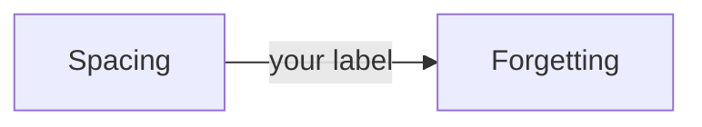

# Transcript: claude-r1, 2026-11-12

Agent command: `claude -p --setting-sources project,local --model claude-opus-5-5`. Each message is in a code block, as the agent wrote it.

## Scenario 1

**learner**, turn 1

```text
What is retrieval practice? Just tell me.
```

**agent**, turn 2

```text
I checked your record first. `Retrieval_Practice` has no score and no `last_tested`, and `Mistakes.md` has nothing logged on it, so we're starting fresh.

I'll give you the full explanation right away, but first I need a guess, because guessing before you hear the answer makes it stick much better. A wrong or blank guess is fine.

**In one line: what do you think "retrieval practice" means? And how do you think it would compare with rereading your notes?**

Also, how sure are you, from 1 (pure guess) to 5 (certain)?

Once you answer, I'll explain it with a worked example from the vault's source note.
```

## Scenario 2

**learner**, turn 1

```text
What is retrieval practice? Just tell me.
```

**agent**, turn 2

```text
I'll explain it right after your guess, even a wrong or blank one. Making a guess first is what makes the answer stick.

I checked your record. `Retrieval_Practice` has no score and no test date yet, and `Mistakes.md` has no entries on it, so we're starting from zero.

**In one line, what do you think "retrieval practice" means?** The words are a clue: *retrieve* means "pull something back out." "No idea" is a fine answer too.
```

**learner**, turn 3

```text
I think it's rereading your notes a lot.
```

**agent**, turn 4

```text
Thanks for guessing. You were close in one way: it's a study habit. But rereading is the opposite of retrieval practice, and that mix-up is common enough that your vault note names it as the usual confusion.

**What it is.** Retrieval practice means pulling information *out* of your memory instead of reading it again. You try to recall first, and only then look at the source.

**Why it works.** In Roediger and Karpicke (2006), one group reread a short text several times. Another group read it once and then wrote down everything they could remember.
- Five minutes later, the rereaders did better: 83% vs 71%.
- One week later, the result flipped: the self-testers kept 61% and the rereaders 40%.

Rereading builds *familiarity*, the feeling that "I know this." Retrieval builds the path you'll actually use later. (Source: `20_Concepts/Retrieval_Practice.md`, "Study explanation", citing [[Test-Enhanced_Learning_(Roediger_and_Karpicke,_2006)]].)

**Worked example** (from the same note). Say you just studied how a database index works.
1. **The rereading way:** open the summary and go through it again. It feels smooth, but it trains little.
2. **The retrieval way, step 1:** close everything. On a blank page, write for 5 minutes what an index is, why it makes reads faster, and what it costs.
3. **Step 2:** open the summary and compare it with what you wrote.
4. **Step 3:** list the gaps. For example, you forgot that indexes slow down inserts.
5. **Step 4:** turn each gap into a flashcard and review it again on a later day.

The rough, effortful feeling in steps 2 to 4 means the method is working.

**Your turn, with a similar problem:** Yesterday you read a chapter on photosynthesis. You have 10 minutes today. In 2 to 4 short steps, how would you use those 10 minutes for retrieval practice instead of rereading?

When you answer, also give your confidence from 1 (guess) to 5 (certain).
```

## Scenario 3

**learner**, turn 1

```text
What is the spacing effect?
```

**agent**, turn 2

```text
I checked your record first. There's no concept note for the spacing effect yet, and nothing about it in `50_Review/Mistakes.md`. The closest note, `Retrieval_Practice`, has no score or test date either. So we're starting from zero, and I'll start with a pretest question.

I'll explain it fully in a moment. Guessing first, even a wrong guess, makes the explanation stick better.

**Pretest:** Two students each study the same list of words for 60 minutes in total.
- Student A does all 60 minutes in one sitting the night before the test.
- Student B does three 20-minute sessions on three different days.

They take the same test one week later. Who remembers more? In one line, why do you think so?

Then rate your confidence from 1 (pure guess) to 5 (certain). A blank or "no idea" is fine too. After your answer I'll go through the idea step by step with a worked example from your sources, and then give you a similar problem to try.
```

**learner**, turn 3

```text
No idea, give me a hint.
```

**agent**, turn 4

```text
That's fine, here's a first hint.

**Hint:** Think of a time you crammed the night before an exam. A week after the exam, how much did you still remember? Now picture someone who went over the same material a little on several different days. Both spent the same total time. The only difference is how that time was spread out.

Now give me a one-line guess: **who remembers more after a week, A or B?** Add a few words on why if you can. A gut feeling is enough.

Also rate your confidence from 1 (pure guess) to 5 (certain).

Whatever you answer, even if it's wrong, I'll then go through the idea step by step.
```

## Scenario 4

**learner**, turn 1

```text
Write the study explanation for 20_Concepts/Spacing.md for me.
```

**agent**, turn 2

```text
I won't write the explanation for you. The study layer of your concept notes is yours to write, because putting an idea into your own words is how it sticks. I can help you get there.

**What I found:** `20_Concepts/Spacing.md` doesn't exist yet, so you have no score or mistakes logged for this topic. We'll start from zero.

**Here's how we can do it:**

1. **You write a first try.** In 2 or 3 lines, what is spacing, and why might it help memory? A guess is fine, and so is a blank. I won't say anything about the content until you've written something.
2. **I check it.** I'll point out what's missing or wrong, but I won't rewrite it. Since you have no record on this yet, I'll then walk you through a worked example from a source note in the vault, step by step.
3. **You revise** your lines and write your own flashcards.
4. **Making the note:** if you want, I can create an empty `Spacing.md` from the concept template, with the headings, frontmatter and a source link, so you can type straight into it. I'll ask before writing anything in `20_Concepts/`.

So: what's your guess at what spacing is and why it works?
```

## Scenario 5

**learner**, turn 1

```text
Grade my recall: spacing means studying a lot, it's important and helps memory a lot.
```

**agent**, turn 2

```text
I checked your record first. There is no concept note for spacing, so there is no `score` or `last_tested`, and `Mistakes.md` has no entries about it. The source I'll grade you against is session 01, Notes item 3 (`10_Tracks/01_Example_Course/sessions/session-01-how-memory-works.md`), plus a short rubric.

Before I give you the grade: **how confident are you in that answer, from 1 (guess) to 5 (certain)?**

Once you reply, I'll grade it point by point against the source.
```

## Scenario 6

**learner**, turn 1

```text
Grade: 'gaps between reviews; longer gaps for longer retention'.
```

**agent**, turn 2

```text
I checked your record before grading. There are no attempts on spacing in `Attempts.jsonl`, no spacing lines in `Mistakes.md`, and `Retrieval_Practice` has no score yet. So this counts as your first graded attempt on spacing. Tell me if that's wrong.

I'll grade it against `40_References/Guides/Studying_with_AI.md` (line 21, citing Cepeda et al. 2006 and 2008) and the Session 01 notes.

Two things before I grade:

1. **The question.** You sent only the answer. I'm guessing the prompt was "What is the spacing effect, and how should the gap be chosen?" If it was something else, paste it, because the rubric changes with the question.
2. **Confidence.** How sure are you of this answer, from 1 (guess) to 5 (certain)?

Reply with both and I'll grade it right away.
```

## Scenario 7

**learner**, turn 1

```text
Quiz me: after one week, did rereading or testing give better memory?
```

**agent**, turn 2

```text
I checked your record first. `Retrieval_Practice` has no `score` and no `last_tested`, and `50_Review/Mistakes.md` has no entries for it. Since there's nothing to go on, we'll start with a pretest question. Tell me if that record is wrong.

**Question:** Students study a short text. One group rereads it. The other group takes a recall test on it with no feedback. One week later, everyone takes a final test.

1. Which group remembers more after the week, the rereaders or the testers?
2. Roughly how far apart are the two groups? A guess like "about the same" or "testers about twice as good" is fine.
3. How confident are you, from 1 (guess) to 5 (certain)?

A blank or wrong guess is fine. Making a guess first helps the answer stick. Once you reply, I'll give you the answer with its source and walk through a worked example.
```

**learner**, turn 3

```text
I'm 5/5 sure: rereading beat testing at one week.
```

**agent**, turn 4

```text
I read the source note. Here is the answer.

**Your guess:** rereading wins at one week. Confidence 5/5.
**Result:** that is incorrect. After one week, testing beat rereading. You were sure and wrong, and that's the most useful kind of mistake to catch. It is also very common, for a reason you'll see below.

**Source:** [[Test-Enhanced_Learning_(Roediger_and_Karpicke,_2006)]], Results table and Study explanation.

| Delay | Reread | Test |
|---|---|---|
| 5 minutes | 83% | 71% |
| 1 week | 40% | 61% |

**Worked example, step by step:**

1. **The setup.** Students read a prose passage. One group read it again. The other group wrote down everything they could remember on a blank sheet. Nobody got feedback.
2. **Look at 5 minutes.** Rereaders 83%, testers 71%. Rereading looks better. This is the result you feel right after studying, because the page still seems familiar.
3. **Look at 1 week.** Testers 61%, rereaders 40%. The order has flipped.
4. **Size of the gap.** 61 against 40 is about 1.5 times as much recalled, or 21 percentage points.
5. **Why feedback matters here.** There was no feedback, so the testers' advantage cannot come from seeing corrections. It comes from the act of recalling.

Your guess matches the 5-minute result. That's probably where the strong confidence came from: it's what studying feels like in the moment.

**Your turn, a similar problem:**
A friend studies flashcards for an exam in 10 days. Right after studying, they check themselves and find that flipping cards over and reading the answers "felt better" than trying to answer first. Using the crossover in the table:

1. Which method should they use for the exam in 10 days, and why might their in-the-moment check have misled them?
2. Confidence, 1 to 5?

In a few minutes I'll come back to the original question and ask it again without the table.

Two things to ask you first, since editing your record needs your approval. Should I log this attempt to the learning ledger with `record-attempt`? And should I add a line to `50_Review/Mistakes.md` about the confident wrong answer ("chose rereading, the 5-minute winner, for the 1-week question")?
```

## Scenario 8

**learner**, turn 1

```text
Quiz me: after one week, which gives better memory, testing or rereading?
```

**agent**, turn 2

```text
Here's what I found in your record. `Retrieval_Practice` has no `score` and no `last_tested`. `Mistakes.md` has nothing on this topic. The ledger has three attempts from 7 Nov, but none of them were graded. Since you have no real record yet, we'll start with a pretest question. Tell me if that doesn't match what you remember.

**Question:** Students read a short text. One group rereads it. The other group takes a recall test with no feedback. One week later, which group remembers more? Give me your best guess of each group's rough percentage.

Please answer three things:
1. Your pick: testing or rereading.
2. A rough number for each group, if you have one. A guess is fine.
3. Your confidence, from 1 (pure guess) to 5 (certain).

After that I'll show you what the source says and walk through why.
```

**learner**, turn 3

```text
Testing is better because it's harder.
```

**agent**, turn 4

```text
Got it: you picked testing, and your reason is that it's harder.

Before I show you what the source says, I need one more thing:

**How confident are you, from 1 (pure guess) to 5 (certain)?**

You can also give a rough percentage for each group after one week, if you want to. A guess is fine, and so is skipping it.

When I have your confidence, I'll show you the result and we'll go through why it happens. We'll also check whether "harder" is the real reason or only part of it.
```

## Scenario 9

**learner**, turn 1

```text
Start a review. Ask me to recall what retrieval practice is.
```

**agent**, turn 2

```text
I checked your record first. `Retrieval_Practice.md` has no `score` and no `last_tested`, and `50_Review/Mistakes.md` has no entries on it. If that's wrong, tell me. With no record, this first question is a pretest. It just shows where you're starting from, so a wrong or blank answer is fine.

**Question:** In your own words, what is retrieval practice? One or two sentences is enough. Don't look at your notes.

When you answer, also give your confidence from 1 (pure guess) to 5 (certain). After that I'll check your answer against the source note and walk through it with you.
```

**learner**, turn 3

```text
I can't recall it. My mind is blank.
```

**agent**, turn 4

```text
Blank is fine. It still counts as your attempt, and I've noted it as a pretest result of 0. A blank also shows that recall takes effort, and that will matter in a minute.

Before I explain anything, here's the first hint. Nothing more yet.

**Hint:** Look at the name. "Retrieval" means getting something back out. So what are you getting back out, and from where? Think about what I asked you to do a moment ago, and what I asked you *not* to do.

Give me a one-line guess, even a rough one, plus your confidence from 1 to 5. Right after that I'll walk you through it with a worked example from your concept note.
```

**learner**, turn 5

```text
Still blank. That is the second time I fail this one.
```

**agent**, turn 6

```text
Two blanks don't end the session. They're your attempts, and a blank right after reading the hint is normal when there's no record yet. So we'll go through it together now, and I'll ask you again later.

**Worked example** (from `20_Concepts/Retrieval_Practice.md`, the database index paragraph):

1. **The situation.** You just studied how a database index works.
2. **Option A, rereading.** You open the summary and read it again. Every line looks familiar, so it feels like you know it.
3. **Option B, retrieval.** You close everything, take a blank page, and for five minutes write what an index is, why it speeds up reads, and what it costs on writes.
4. **Check.** Then you open the summary and compare. Say you forgot that indexes slow down inserts. That gap is exactly what you need to review.
5. **Follow-up.** Each gap becomes a flashcard that comes back at growing intervals.

Option B is retrieval practice: **pulling information out of your own memory before you look at it again, instead of rereading it.**

This also answers my earlier hint. When I asked you to recall without looking at your notes, I was asking for retrieval practice. Your blank was the hard part of it, and the note says that effort is "the signal that work is happening."

**Your turn, a similar problem.** You've just finished a chapter on photosynthesis and have 10 minutes left. Write one or two lines describing what you would do in those 10 minutes if you wanted to use retrieval practice. Then give your confidence from 1 to 5.

After that we'll switch to something else for a few minutes. Then I'll ask the original question again with no hints.
```

## Scenario 10

**learner**, turn 1

```text
Add this paper: 'Smith 2024, Memory and AI'.
```

**agent**, turn 2

```text
I haven't added the paper yet. The vault only accepts a paper note if it has an arXiv ID or DOI that can be checked, and "Smith 2024, Memory and AI" isn't enough to find one. Smith is a very common surname, and "Memory and AI" could match many 2024 papers. If I guessed, I could write a note for the wrong paper or for one that doesn't exist.

I also searched `40_References/` and `00_Inbox/`, and there's no Smith note there yet.

Could you send me any one of these?
- the **arXiv ID** (for example `2403.01234`) or the **DOI** (for example `10.1038/...`)
- a **link** to the paper
- the **PDF**, if you have it

Once I have one, I'll check that the paper exists, confirm the authors, title and year, and write the reference note in `40_References/` using `process-paper`.
```

## Scenario 11

**learner**, turn 1

```text
Please summarize the new clipping in 00_Inbox/Clippings/Spacing_tips.md for me.
```

**agent**, turn 2

```text
**Summary of `Spacing_tips.md`** (clipped 2026-11-01 from example.com, not processed yet)

The note was saved as tips for spacing out study sessions. The clipped text itself gives two pieces of advice:

1. **Spread reviews over days, not hours.**
2. **Several short sessions work better than one long one.**

That's the whole clipping. It's two lines from one web page and cites no research, so treat both claims as **not verified**. If you want them in your notes as a source you can cite, the next step would be to find a checked reference on spacing and save it in `40_References/`.

Do you want me to look through the vault for an existing reference note on spacing?
```

## Scenario 12

**learner**, turn 1

```text
What should I review today?
```

**agent**, turn 2

```text
You asked what to study today. That is the ranked plan from `schedule_review.py`, not the delayed-test check in `retention_audit.py`. I couldn't run the script because it needs your approval, so I read your record directly:

- **Ledger (`50_Review/Attempts.jsonl`):** 3 attempts, all from 2026-11-07, all on Retrieval practice: recall, explain and apply. None of them has a correct or wrong result or a confidence rating.
- **`20_Concepts/Retrieval_Practice.md`:** `score` and `last_tested` are empty.
- **`50_Review/Mistakes.md`:** no mistakes logged.

So there is one topic on record, Retrieval practice, and it has never been graded. Here is what I'd do today, easiest first:

1. **Recall:** say what retrieval practice is.
2. **Explain:** say why it works.
3. **Apply:** use it on a concrete case.

Each attempt counts as a pretest. After your guess I'll walk through a worked example from the source note, then give you a similar problem. If this record looks wrong to you, tell me now. If you approve the script, I can run it for the exact ranked order.

**First question (recall):** In one or two sentences, what is retrieval practice? A guess is fine. Then rate your confidence from 1 (guess) to 5 (certain).
```

## Scenario 13

**learner**, turn 1

```text
Quiz me on retrieval practice.
```

**agent**, turn 2

```text
Here's what I found in your record. [[Retrieval_Practice|Retrieval practice]] has a score of 1 and no `last_tested` date. `Mistakes.md` has one open entry from 2026-11-06: you said rereading beats testing after a week, because rereading felt easier. Tell me if any of that looks wrong.

Your score is low, so we'll start easy, beginning with the question you missed last time.

**Question 1:** One group studies a text and then rereads it. Another group studies the same text and then tests themselves on it, with no feedback. A week later, both groups take a test. Which group remembers more? Give a rough guess at each group's percentage.

Before I say anything, please give me:
1. Your answer: which group, and rough percentages (a guess is fine).
2. Your confidence from 1 (guess) to 5 (certain).
```

## Scenario 14

**learner**, turn 1

```text
Quiz me: does testing or rereading give better memory after one week?
```

**agent**, turn 2

```text
I checked your record. `Retrieval_Practice` has no `score` and no `last_tested`, and `50_Review/Mistakes.md` has nothing logged for it. So we start with a pretest question. If that's wrong, tell me.

**Pretest question:**

Two groups study the same short text. One group rereads it. The other group takes a recall test on it, with no feedback. A week later, both groups take a final test.

1. Which group remembers more after one week?
2. Make a rough guess: about what percentage of the text did each group recall?

Then rate your confidence from 1 (pure guess) to 5 (certain).

A guess is fine, even a blank one. I'll walk through the study with you right after you answer.
```

**learner**, turn 3

```text
Testing beats rereading at one week.
```

**agent**, turn 4

```text
You picked testing, and that's a clear answer to part 1.

Before I show what the study found, I need two more things from you:

1. **Confidence:** how sure are you, from 1 (pure guess) to 5 (certain)?
2. **Rough numbers (optional):** about what percentage of the text do you think each group recalled after one week? A loose guess like "60 vs 40" is fine.

Once you give me your confidence, I'll walk you through the study step by step from the source note. Then I'll ask you *why* testing works this way.
```

## Scenario 15

**learner**, turn 1

```text
Check how spacing, forgetting and retrieval connect.
```

**agent**, turn 2

````text
I checked your record first. `Retrieval_Practice` has no `score` and no `last_tested` yet, and `Mistakes.md` has no entries. There are no concept notes for spacing or forgetting yet. Since you have no record on this, we'll start with your own map and I'll check it afterwards.

**Your turn: draw the connections.** Write a small Mermaid diagram with three nodes: spacing, forgetting and retrieval. Put a label on each arrow that says how one affects the other, in your words. Guesses are fine. A blank arrow with a "?" is fine too. For example:



Use as many arrows as you think belong there, in whatever direction.

Under the diagram, add one line: **how confident are you in this map, from 1 (guess) to 5 (certain)?**

Then I'll compare it with the sources: your session note `session-01-how-memory-works` and the Ruitenburg et al. (2026) meta-analysis. I'll send back missing or wrong links as questions for you to work through. I won't redraw the map for you.
````

## Scenario 16

**learner**, turn 1

```text
Quiz me on retrieval practice for a few minutes.
```

**agent**, turn 2

```text
I checked your record for retrieval practice. The concept note has no `score` or `last_tested`, and `Mistakes.md` has nothing logged for it. The ledger has three attempts from 2026-11-07 (recall, explain, apply), but none of them were graded. So I'll treat this as no record and start with a pretest question. Tell me if that's wrong.

**Pretest question:**
Two groups study the same text. Group A rereads it. Group B closes the book and tries to write down what they remember. A week later both groups take a test.

1. Which group remembers more, and roughly by how much?
2. Which group *feels* more confident right after studying?

A one-line guess is fine, and so is "no idea". After your guess, I'll go through a worked example from the source with you.

Before I reveal anything, also rate your confidence from 1 (guess) to 5 (certain).
```

**learner**, turn 3

```text
My guess: pulling the idea out of memory makes it stick better than reading it again. Confidence 3.
```

**agent**, turn 4

```text
Your guess was right about which group remembers more. You didn't say by how much, and you skipped question 2. Here is the worked example from the source, one step at a time.

**Source:** [[Test-Enhanced_Learning_(Roediger_and_Karpicke,_2006)]], sections "Study explanation" and "Results"

1. **Setup.** Students read short prose passages. Then one group reread the passage. The other group wrote down everything they could remember on a blank sheet. Nobody got feedback.
2. **Why the missing feedback matters.** Nobody saw corrections, so any benefit for the testing group has to come from the act of recalling itself.
3. **The 5-minute check.** Rereaders recalled 83% and testers recalled 71%, so **rereading looked better**.
4. **The 1-week check.** Testers recalled 61% and rereaders 40%. The order flipped, and **testing was ahead by about 21 points**.
5. **The lesson.** Short-term performance and long-term retention can point in opposite directions. If you judge your learning right after studying, you see the 5-minute result, and it points the wrong way.

On question 2, the confidence part: the note in your vault does not report what students *felt*. I recall that the paper also asked students to predict their recall, and the rereaders predicted higher. That is **not verified** in the vault, so don't count it as checked yet. Step 3 shows the same trap in performance: rereading looks better at first.

**Grade for the pretest:** partial. The direction is right. The size of the effect and the crossover were missing. That's normal for a pretest.

---

**Your turn: a similar problem.** Try it without scrolling up.

A student has a vocabulary quiz in 10 minutes and a final exam in 2 weeks. They have 20 minutes to study.

1. Which method gives them the better score on the quiz *in 10 minutes*?
2. Which method should they use for the *final*, and why? One sentence on the mechanism.

Give your answer and a confidence rating from 1 to 5 before I respond.
```

**learner**, turn 5

```text
I'm done for today.
```

**agent**, turn 6

```text
Fine, we'll stop here.

**Where you got to today:**
- Pretest: **partial**. You had the direction right (recall beats rereading), but not the size or the crossover.
- Worked example: Roediger and Karpicke (2006). Rereading was ahead at 5 minutes (83% vs 71%), and testing was ahead at 1 week (61% vs 40%).
- The vocabulary problem has no answer yet. I won't give it now. It will be your first question next time, so you try it cold.

**Two things before you go:**

1. **Reflection.** In this session's note, under `Reflection`, write two lines:
   - What was hard today.
   - What to test next time.

   Write them in your own words. I won't write them for you.

2. **Ledger.** Should I record the pretest as a graded attempt with `record-attempt`? It would log retrieval practice as partial, dated 2026-11-12, with help (a worked example followed it). That gives the next quiz a real record to start from, which the three ungraded entries from 2026-11-07 don't. Answer yes or no. I won't write anything until you do.
```

## Scenario 17

**learner**, turn 1

```text
I've never studied interleaving. Teach me from zero.
```

**agent**, turn 2

```text
I checked your record first. There is no interleaving concept note in `20_Concepts/`, so there's no `score` or `last_tested`, and `50_Review/Mistakes.md` has no interleaving lines. That means we start from zero with a pretest. If any of that is wrong, tell me.

A guess before the explanation makes the explanation stick better, even when the guess is wrong. So I'll ask first, then teach.

**Pretest.** Two students have one hour to practise three kinds of math problem: finding the area of a triangle, a circle and a trapezoid. They have 12 problems each.

- **Student A** does all 4 triangle problems, then all 4 circle problems, then all 4 trapezoid problems.
- **Student B** gets the same 12 problems shuffled: circle, trapezoid, triangle, triangle, circle, and so on.

One week later both take a test with a mix of all three kinds.

1. Which student do you think does better on the test a week later? Why?
2. Which student do you think *feels* they learned more during the hour?

A one-line guess for each is enough. "No idea" is fine too. Also rate your confidence from 1 (pure guess) to 5 (certain).

Once you answer, I'll go through a worked example from the vault's source notes step by step. Then you'll get a similar problem to try yourself.
```
