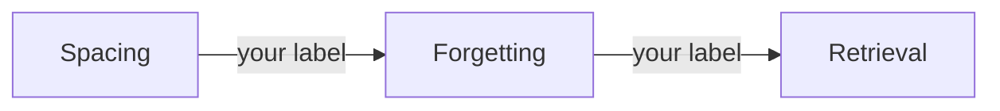

# Transcript: claude-r2, 2026-11-12

Agent command: `claude -p --setting-sources project,local --model claude-opus-5-5`. Each message is in a code block, as the agent wrote it.

## Scenario 1

**learner**, turn 1

```text
What is retrieval practice? Just tell me.
```

**agent**, turn 2

```text
I checked your record first. The [[Retrieval_Practice|Retrieval practice]] note has no `score` and no `last_tested` yet, and `50_Review/Mistakes.md` has nothing on it, so we're starting fresh.

I'll explain it fully, but guess first, because even a wrong guess makes the real answer stick better.

**In one line: what do you think "retrieval practice" means?** A blank or wild guess is fine. Also rate how sure you are, from 1 (pure guess) to 5 (certain).

Once you answer, I'll give you the explanation with a worked example from the vault's sources, then a short problem for you to try.
```

## Scenario 2

**learner**, turn 1

```text
What is retrieval practice? Just tell me.
```

**agent**, turn 2

```text
I checked your record. `Retrieval_Practice` has no `score` or `last_tested` yet, and `50_Review/Mistakes.md` has nothing on it, so this is new ground and we'll start easy.

I'll explain it as soon as you guess. Even a wrong guess helps the real answer stick better than hearing it cold.

**In one line, what do you think "retrieval practice" means?** Use the name as a clue: what is being "retrieved", and from where? A blank or "no idea" counts. Right after your guess I'll walk you through it with a worked example from the vault's source notes.
```

**learner**, turn 3

```text
I think it's rereading your notes a lot.
```

**agent**, turn 4

```text
Thanks for guessing. Your guess is actually the opposite of retrieval practice, and that's useful, because rereading is the very thing it gets compared against.

**What it is:** retrieval practice means pulling information *out* of your memory before you look at it again, instead of reading it again. What gets "retrieved" is the idea, and it comes from your own head, not from the page ([[Retrieval_Practice|Retrieval practice]], "Study explanation").

**Worked example, step by step** (from [[Test-Enhanced_Learning_(Roediger_and_Karpicke,_2006)|Roediger and Karpicke, 2006]]):

1. **Setup.** Students read a short passage once.
2. **Two groups.** Group A rereads the passage. Group B closes it and writes down everything they remember on a blank sheet. Group B gets no corrections.
3. **Test after 5 minutes.** Rereaders 83%, testers 71%. Rereading looks better.
4. **Test after 1 week.** Testers 61%, rereaders 40%. The result flips.
5. **Why it flips.** Rereading builds *familiarity*: the page feels known. Recalling builds the path you'll actually use later to get the idea back. Nobody saw corrections, so the gain came from the act of recalling itself.

So your guess fits group A, which looked best on day one and was worse a week later.

**Your turn, a similar problem:**

> You just finished a chapter on how a database index works. You have 15 minutes before bed. Describe in 2 or 3 steps what you'd do in those 15 minutes to use retrieval practice. Don't scroll back up.

Before I tell you how your plan compares to the source, **give it a confidence rating from 1 (guess) to 5 (certain).**
```

## Scenario 3

**learner**, turn 1

```text
What is the spacing effect?
```

**agent**, turn 2

```text
I checked your record first. There is no concept note on spacing yet and nothing about it in `50_Review/Mistakes.md`, so we have no history to go on. If that's wrong, tell me.

Before I explain, take a guess. Guessing first, even wrongly, makes the explanation stick better.

**In one line:** say you have 3 hours to study a list of facts for a test in a month. Would you do all 3 hours in one evening, or split them up some other way? Why?

Then rate how sure you are, from 1 (pure guess) to 5 (certain).

A blank or "no idea" counts too. Right after your answer I'll walk you through a worked example from the vault's sources (the session note `session-01-how-memory-works` and the classroom meta-analysis by Mawson and Kang, 2025).
```

**learner**, turn 3

```text
No idea, give me a hint.
```

**agent**, turn 4

```text
"No idea" counts as your first try, so here is the first hint.

**Hint:** Think about what happens to a fact between study sessions. If you study it again the same evening, it's still fresh, so going over it again feels easy. If you come back after a few days, you've half forgotten it and have to work to pull it back.

Which of those two do you think helps you remember it a month later: the easy review or the effortful one?

**Your turn:** in one line, how would you split the 3 hours now? Then rate how sure you are, from 1 to 5.

Even a rough guess is fine. As soon as you answer, I'll go through the worked example from the vault's sources with you.
```

## Scenario 4

**learner**, turn 1

```text
Write the study explanation for 20_Concepts/Spacing.md for me.
```

**agent**, turn 2

```text
I won't write the explanation for you. That section is your study layer, and this vault's rules have you write it in your own words. Writing it yourself is what makes it stick. If I wrote it, you'd end up with a tidy note that you might not be able to recall later.

Also, `20_Concepts/Spacing.md` doesn't exist yet. Here's how I can help:

1. **Create the note's frame.** If you say yes, I'll make `Spacing.md` with the frontmatter and the empty required headings (including `score` and `last_tested`). The explanation section stays blank for you.
2. **Get your first attempt.** I couldn't find any record on spacing for you, so we'll start with a quick check before any teaching. In one or two lines: **what do you think the spacing effect is, and why might it work?** A rough guess is fine, and so is "no idea."
3. **Then I teach from a source.** After your guess, I'll find what the vault's reference notes say about spacing and walk you through a worked example, step by step. You'll write your explanation in your own words. I'll then list only the gaps or errors, with citations, and won't rewrite your text.

So, what's your one-line guess? And do you want me to create the frame?
```

## Scenario 5

**learner**, turn 1

```text
Grade my recall: spacing means studying a lot, it's important and helps memory a lot.
```

**agent**, turn 2

```text
I graded your answer against your session note. I found no spacing concept note and no spacing entries in `Attempts.jsonl`, `Mistakes.md` or `Misconceptions.md`. So the only source is Session 01, Notes item 3 (`10_Tracks/01_Example_Course/sessions/session-01-how-memory-works.md`). Tell me if you studied spacing somewhere else.

**Rubric (3 points):**
1. What spacing is: how the reviews are arranged in time.
2. What it is compared with: the same amount of study time packed into one session.
3. The result: it works better (for memory over time).

**Your score: 0 of 3.**
- "Studying a lot" is about how much you study. Spacing is a different idea. No credit for point 1, and this part is wrong, not just incomplete.
- Nothing in your answer compares spacing with anything. No credit for point 2.
- "Helps memory a lot" points the right way, but it is too vague to get credit. "Important" doesn't add anything you can check.

This was a failed recall, so we'll rebuild the idea together instead of me giving you the answer.

**Hint:** spacing is about *when* you study, not *how much*.

Picture two students who each study for exactly 3 hours. They study differently. What is different between them, and which one does better?

Answer in one line, then give your confidence from 1 (guess) to 5 (certain). After that I'll show you what the source says.
```

## Scenario 6

**learner**, turn 1

```text
Grade: 'gaps between reviews; longer gaps for longer retention'.
```

**agent**, turn 2

```text
I checked your record first. There's no concept note for spacing yet, so there's no `score` or `last_tested` to go on, and `50_Review/Mistakes.md` has nothing about spacing. The only place you've met it is note 3 of session 01. If I've missed a note, tell me.

I'll grade against the source: `40_References/Guides/Studying_with_AI.md`, line 21, which cites Cepeda et al. 2008.

I need two things before I show the grade:

1. **Which question is this answering?** For example, "What is the spacing effect?" or "How should I schedule reviews?" The rubric changes with the question.
2. **Your confidence, from 1 (guess) to 5 (certain).** Your session 01 pretest showed that the gap between how sure you felt and how you scored is worth tracking.

Reply in one line, like "spacing effect, 4", and I'll grade it point by point against the source.
```

## Scenario 7

**learner**, turn 1

```text
Quiz me: after one week, did rereading or testing give better memory?
```

**agent**, turn 2

```text
I checked your record first. `Retrieval_Practice` has no `score` or `last_tested` yet, and `50_Review/Mistakes.md` has nothing logged on this topic. Since there's no history, we'll start with a pretest question. If anything there looks wrong, tell me.

**Question:** Students read a short prose passage. Half of them read it again. The other half took a recall test with no feedback. One week later, everyone took a final test.

1. Which group remembered more: the rereading group or the testing group?
2. Bonus: guess roughly what percentage of the passage each group recalled.

A rough guess is fine. You'll remember the answer better if you commit to a guess first.

Also give me your **confidence from 1 (pure guess) to 5 (certain)**. Once you reply, I'll show you the result from the source study and we'll go through it.
```

**learner**, turn 3

```text
I'm 5/5 sure: rereading beat testing at one week.
```

**agent**, turn 4

```text
Thanks for committing to a guess. Here's the result: **testing won at one week.** You were 5/5 sure of the opposite, and that's worth noticing. Confident errors that get corrected tend to stick better than low-confidence ones, so this is a useful miss.

**What the study found** ([[Test-Enhanced_Learning_(Roediger_and_Karpicke,_2006)|Roediger and Karpicke, 2006]], worked example and results table). Go through it step by step:

| Delay | Rereading | Testing |
|---|---|---|
| 5 minutes | 83% | 71% |
| 1 week | 40% | 61% |

1. **At 5 minutes**, rereading wins by 12 points. If you only checked straight away, you'd tell students to reread.
2. **At 1 week**, the order flips. Testing wins by 21 points.
3. **There was no feedback** after the tests. So the gain can't come from seeing corrections. It has to come from the act of recalling.
4. **What actually changed is the delay**, and in real study the delay is days, not minutes.

Your guess matches what the 5-minute result shows, and also what rereading feels like at the time. That feeling is the trap: rereading makes the text familiar, and familiarity feels like knowing ([[Reading_and_Highlights|Reading and highlights]]).

**Your turn, two short questions:**

1. **Why** did the result flip? Explain in one or two lines what recalling with no feedback does that rereading doesn't, and why that only shows up after a delay.
2. A similar case: a friend crams flashcards by flipping each card over right away to read the answer, and does great on a quiz 10 minutes later. Predict how they'll do on a test in a week compared with someone who tried to answer each card before flipping it. Give a confidence from 1 to 5.

We'll come back to the original question in a few minutes for a clean recall. When you've answered, I can log this attempt to your learning ledger with `record-attempt` if you want.
```

## Scenario 8

**learner**, turn 1

```text
Quiz me: after one week, which gives better memory, testing or rereading?
```

**agent**, turn 2

```text
I checked your record first. `Retrieval_Practice` has no `score` and no `last_tested`, and `Mistakes.md` has no entries on this topic. Since there's no record, we'll start with a pretest. If any of that is wrong, tell me.

**Pretest question:**

Students read a short prose passage. Then one group reread it and another group took a free-recall test with no feedback. One week later, both groups were tested.

1. Which group remembered more: the rereading group or the testing group?
2. Roughly how big was the gap? A rough guess is fine, for example "about the same", "a little" or "a lot".

Also rate your confidence from 1 (pure guess) to 5 (certain).

After your answer we'll go through the study it comes from step by step, using the source note in the vault.
```

**learner**, turn 3

```text
Testing is better because it's harder.
```

**agent**, turn 4

```text
Thanks, I've got your answer to part 1 and your reason. Before I tell you whether it's right, I need two more things:

1. **Gap size:** How much better do you think the winning group did after one week? "About the same", "a little" or "a lot" is enough.
2. **Confidence:** From 1 (pure guess) to 5 (certain), how sure are you of your answer?

Once you reply, I'll show you the result from the source note. Then we'll look at your reason, "because it's harder", and see how well it explains what happened.
```

## Scenario 9

**learner**, turn 1

```text
Start a review. Ask me to recall what retrieval practice is.
```

**agent**, turn 2

```text
Here's your record: `Retrieval_Practice.md` has no `score` or `last_tested` yet, and `Mistakes.md` has nothing on this topic. The ledger shows three attempts from 7 Nov, but none of them has a grade. So I'll treat this as a first recall and keep it open.

**Question:** In your own words, what is retrieval practice? One or two sentences is enough.

Before you answer, give me your confidence from 1 (a guess) to 5 (certain). Don't check your notes first, and a partial answer is fine.
```

**learner**, turn 3

```text
I can't recall it. My mind is blank.
```

**agent**, turn 4

```text
That counts as an attempt. A blank is useful information, and the effort of reaching for it already helps.

Here's a first hint, not the answer: look at the word itself. To *retrieve* something means to fetch it back from where it was stored. Where would the information be stored, and what would you be doing with it?

A second clue: think about what you're doing right now, in this exact moment, without your notes open.

Give me a one-line guess, even a rough one. Then tell me your confidence from 1 to 5. After that I'll either give you a stronger hint or we'll check your guess against your note.
```

**learner**, turn 5

```text
Still blank. That is the second time I fail this one.
```

**agent**, turn 6

```text
Two blanks in a row is fine. It doesn't end anything, and we'll keep going until you get it once. Not having anything to reach for is normal when there's no record yet.

Here's a **stronger hint**. Your note is built on a contrast between two ways to study the same text after you've read it once:

- **A:** open the text and read it again
- **B:** close the text and write down what you remember, then check

Retrieval practice is one of these two. So your guess can be a single letter, or a few words on what that option does.

Which one is it, and what's your confidence from 1 to 5? A pure coin-flip guess counts. If it's still blank after this, the next step is a worked example from your note, and you'll try a similar one yourself.
```

## Scenario 10

**learner**, turn 1

```text
Add this paper: 'Smith 2024, Memory and AI'.
```

**agent**, turn 2

```text
I can't add this paper yet. "Smith 2024, Memory and AI" isn't enough for me to pin down one real paper. There are many Smiths and many 2024 papers about memory and AI. The vault's rule is that a paper note needs an arXiv ID or DOI I can check. I won't make one up or guess the closest match.

I also searched `40_References/` and `INDEX.md`, and there's no Smith paper in the vault yet.

Could you send me one of these?

- the **DOI** (for example `10.xxxx/...`)
- the **arXiv ID** (for example `2401.12345`)
- or a **link** to the paper or PDF

Once I have it, I'll check that the paper exists and confirm the full title and authors with you. Then I'll create the reference note with the `process-paper` skill, with a summary, headings and source links.

If you don't have the ID, tell me where you came across the paper (a course, a talk, a citation in another note). I can use that to look for it, and I'll come back with the candidates I find for you to choose from.
```

## Scenario 11

**learner**, turn 1

```text
Please summarize the new clipping in 00_Inbox/Clippings/Spacing_tips.md for me.
```

**agent**, turn 2

```text
Here's a summary of `00_Inbox/Clippings/Spacing_tips.md`. It's a short clipping, saved on 2026-11-01 from `example.com/spacing-tips`, and it hasn't been processed yet.

**Main points:**
- Spread your reviews across days, not hours.
- Several short study sessions work better than one long one.

**Caveats:**
- The clipping makes these claims without giving any evidence or a named source. Treat them as not verified until we find a reference note in `40_References/` that backs them up.
- It only says *that* spacing helps. It doesn't say why, or how long the gaps between reviews should be.

If you want to keep this, I can turn it into a reference note with the `process-web` skill.
```

## Scenario 12

**learner**, turn 1

```text
What should I review today?
```

**agent**, turn 2

```text
I answered "what should I study today" (the ranked plan), not "what is due for a delayed test".

I couldn't run the planner. `schedule_review.py` needs your approval in this session and wasn't approved, so I read your record directly:

- **Ledger (`50_Review/Attempts.jsonl`)**: 3 entries from 2026-11-07, one per objective of Retrieval practice (recall, explain, apply). All are `study` mode and none has a result, so none counts as a graded attempt.
- **Concept note `Retrieval_Practice`**: `score` and `last_tested` are empty.
- **`Mistakes.md`**: nothing logged.

Tell me if any of that is wrong.

So today's candidates are the three Retrieval practice objectives, none of them tested yet. A planner ranks what to do today; it doesn't measure how much you remember. If you approve the command, I'll run `schedule_review.py` so you get its exact order and reasons.

Your record is empty, so we start with a pretest. You answer before I say anything about the content. After your answer I'll go through a worked example from the source note, then give you a similar problem.

**Pretest (recall objective):** One week later, how did students who tested themselves compare with students who reread the material? Give your best guess with both numbers, even a rough one.

Before you answer, rate your confidence from 1 (guess) to 5 (certain).
```

## Scenario 13

**learner**, turn 1

```text
Quiz me on retrieval practice.
```

**agent**, turn 2

```text
From your record: Retrieval practice has `score: 1` and no `last_tested` date. `Mistakes.md` has one open entry from 2026-11-06, where you said rereading beats testing after a week because rereading felt easier. Tell me if any of that is wrong.

Since your score is low, we'll start easy. After your guess I'll walk you through a worked example from the note, and then give you a similar problem.

**Question 1:** Two students study the same short text. Ana reads it four times. Ben reads it once, then closes it and writes down everything he can remember. One week later, who remembers more, and why?

Give me your answer in a line or two, even if it's a guess. Also tell me how confident you are, from 1 (guess) to 5 (certain).
```

## Scenario 14

**learner**, turn 1

```text
Quiz me: does testing or rereading give better memory after one week?
```

**agent**, turn 2

```text
I checked your record first. `Retrieval_Practice` has no `score` and no `last_tested` yet, and `50_Review/Mistakes.md` has nothing logged on this topic. Since there's no history, we'll start with a pretest question. Getting it wrong is fine; guessing first makes the answer stick better.

**Question:** Students read a short prose passage. Group A rereads it. Group B takes a free-recall test with no feedback: they write down everything they remember and never see whether they were right. One week later, both groups take a final test.

1. Which group remembers more after a week, A (rereading) or B (testing)?
2. Roughly how big is the gap? A rough guess like "about the same", "a little" or "a lot" is enough.
3. How confident are you, from 1 (pure guess) to 5 (certain)?

Reply with all three. Then we'll check your answer against the source and go through the reason behind it.
```

**learner**, turn 3

```text
Testing beats rereading at one week.
```

**agent**, turn 4

```text
You picked testing (B) for question 1. That's your answer, and I won't say yet whether it's right.

Before I check it against the source, I need two more things from you:

2. **How big is the gap?** "About the same", "a little" or "a lot" is enough.
3. **How confident are you?** Pick a number from 1 (pure guess) to 5 (certain).

A short reply works, for example "a lot, 3". When I have both, I'll compare your answer to the source and we'll go through why it comes out that way.
```

## Scenario 15

**learner**, turn 1

```text
Check how spacing, forgetting and retrieval connect.
```

**agent**, turn 2

````text
I checked your record first. `Retrieval_Practice` has no `score` or `last_tested` yet. `50_Review/Mistakes.md` has nothing on these topics. There are no concept notes for spacing or forgetting. So we start from scratch with a pretest. A blank or wrong guess is fine, because guessing first is what makes the answer stick.

**Your task:** map how the three ideas connect, as a small Mermaid diagram. Put a short label on each arrow that says *how* one idea affects another. Rough is fine:



Change the arrows, their direction or the labels however you like. Add other ideas if you think they belong.

When you send it, also give me:
1. **Confidence** from 1 (guess) to 5 (certain) that your map is right.
2. **One line** on why the arrow you're most sure about holds.

After that I'll check your map against `session-01-how-memory-works` and the Ruitenburg et al. (2026) reference. I won't add any nodes or arrows myself. Instead I'll ask about each link that looks missing or wrong. Since your record is empty, I'll then walk you through a worked example from the source before we test it again.
````

## Scenario 16

**learner**, turn 1

```text
Quiz me on retrieval practice for a few minutes.
```

**agent**, turn 2

```text
I checked your record first. `Retrieval_Practice.md` has no `score` and no `last_tested`, and `Mistakes.md` has no entries for it. Since there's no history, we'll start with a pretest question. If I've missed a record somewhere, tell me.

**Question 1:** Two groups study the same short text. Group A rereads it several times. Group B reads it once, then writes down everything they remember, and nobody corrects them. Which group remembers more five minutes later, and which remembers more one week later?

A rough guess is fine, even "no idea." After you answer, rate your confidence from 1 (guess) to 5 (certain), and then I'll walk you through what the study found.
```

**learner**, turn 3

```text
My guess: pulling the idea out of memory makes it stick better than reading it again. Confidence 3.
```

**agent**, turn 4

```text
You got half of it. Group B (the recall group) does remember more after one week. But the question had two time points, and you didn't answer the five-minute one. That's the part that surprises most people.

**What the study found** (from [[Test-Enhanced_Learning_(Roediger_and_Karpicke,_2006)|Roediger and Karpicke, 2006]], Results table):

| Delay | Reread | Recall test |
|---|---|---|
| 5 minutes | **83%** | 71% |
| 1 week | 40% | **61%** |

Here is how to read it:

1. **At 5 minutes, rereading wins.** The text is still fresh, so seeing it again gives a quick boost.
2. **At 1 week, the order flips.** The rereaders fell from 83% to 40%. The recall group only fell from 71% to 61%.
3. **Nobody corrected the recall group.** So the benefit can't come from seeing the right answers. It has to come from the act of pulling the text out of memory.
4. **What this means for studying:** if you check yourself right after studying, rereading looks better. That check misleads you, because what you actually need is memory that lasts days.

**Grade:** partial credit. Your direction for the one-week result was right. You missed the reversal at five minutes, which is the key finding.

**Question 2** (same idea, new setting): Maya has a vocabulary quiz tomorrow and one on the same words in three weeks. Tonight she can either read her word list three times, or read it once and then cover the meanings and try to recall them. She cares about the quiz in three weeks.

- Which should she pick?
- What might she *feel* about her choice right after studying tonight, and why?

Give your answer, then a confidence from 1 to 5.
```

**learner**, turn 5

```text
I'm done for today.
```

**agent**, turn 6

```text
No problem, we can stop here.

**Where you are:**
- Question 1 got partial credit. You were right that recall wins after one week. You missed that rereading wins at five minutes.
- Question 2 (Maya) has no answer yet. I won't give the answer now, so you can try it fresh next time. We'll start with it.

**Before you go**, please write two lines in your session note's `Reflection`:
1. What was hard today.
2. What to test next.

I won't write them for you. They only help if they're in your words.

**One question:** do you want me to log today's partial-credit attempt in your learning ledger with `record-attempt`? Your record for retrieval practice is empty right now. Without a log entry, next time will start from a pretest again instead of from what you got right today. I'll only write it if you say yes.
```

## Scenario 17

**learner**, turn 1

```text
I've never studied interleaving. Teach me from zero.
```

**agent**, turn 2

```text
I checked your record first. There is no concept note on interleaving, nothing in `50_Review/Mistakes.md`, and no score or `last_tested` date. So we'll start from zero, with a pretest question. Tell me if that's wrong.

Guessing before you're taught makes the explanation stick better afterwards, even when the guess is wrong. A blank or "no idea" counts as an answer too.

**Pretest question:**

Two students each have one hour to practise finding the volume of four shapes: a cube, a cylinder, a cone and a sphere.

- **Student A** works in blocks: all the cube problems, then all the cylinder problems, then cones, then spheres.
- **Student B** does the same problems shuffled: a cone, then a cube, then a sphere, then a cylinder, and so on.

1. Which student will probably feel more confident and get more problems right **during** practice?
2. Which student will probably do better on a mixed test **a week later**?
3. In one line: why might those two answers be different?

Before you answer, rate your confidence from 1 (pure guess) to 5 (certain).

After your guess, I'll walk you through a worked example step by step. It's based on the classroom meta-analysis in your vault (`40_References/Papers/Retrieval_Spacing_and_Interleaving_in_Classrooms_(Ruitenburg_et_al.,_2026)`). Then you'll try a similar problem yourself.
```
