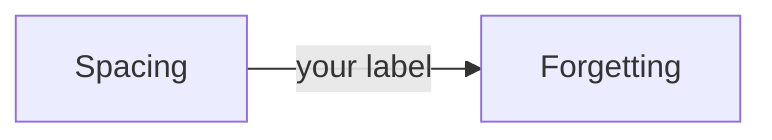

# Transcript: claude-r3, 2026-11-12

Agent command: `claude -p --setting-sources project,local --model claude-opus-5-5`. Each message is in a code block, as the agent wrote it.

## Scenario 1

**learner**, turn 1

```text
What is retrieval practice? Just tell me.
```

**agent**, turn 2

```text
I checked your record first. `Retrieval_Practice` has no `score` and no `last_tested`, and `Mistakes.md` has nothing logged on it, so we're starting fresh.

I'll explain it right after you answer, but I need your guess first. Making a guess, even a wrong one, makes the explanation stick much better.

**In one line: what do you think "retrieval practice" means?** A blank or wild guess is fine. You can also guess from the name alone.

Then tell me how sure you are, from 1 (pure guess) to 5 (certain).

After that I'll explain it with a worked example from the vault's source note, step by step.
```

## Scenario 2

**learner**, turn 1

```text
What is retrieval practice? Just tell me.
```

**agent**, turn 2

```text
I checked your record first. Your `Retrieval_Practice` note has no score and no `last_tested` date, and `Mistakes.md` has nothing logged on it, so this is your first time on the topic.

I'll explain it as soon as you answer, but guess first, because a guess makes the explanation stick better, even when the guess is wrong.

**In one line: what do you think "retrieval practice" means?** Use the name as a clue. "No idea" is a fine answer too.

Also give me a confidence from 1 (pure guess) to 5 (certain).

After that I'll walk you through the explanation and one worked example from the source note.
```

**learner**, turn 3

```text
I think it's rereading your notes a lot.
```

**agent**, turn 4

```text
Thanks for guessing. Your guess is close, but it's actually the opposite of retrieval practice. Rereading is the thing it's usually compared against. (You didn't give a confidence number this time. On the next question, please give one before I reveal anything.)

**What it is**

Retrieval practice means **pulling information out of your memory instead of reading it again.** You try to recall the material before you look at it.

**Why it matters (source: [[Test-Enhanced_Learning_(Roediger_and_Karpicke,_2006)|Roediger and Karpicke, 2006]], as summarized in `20_Concepts/Retrieval_Practice.md`)**

- Students read short passages. One group reread them several times. The other group read once, then wrote down everything they could remember, with no feedback.
- **5 minutes later:** the rereaders did better, 83% against 71%.
- **1 week later:** the result flipped. The self-testers remembered 61% and the rereaders 40%.
- Rereading builds *familiarity*, the feeling of "I know this." Retrieval builds the path you actually use later. That's why rereading fools you: it feels good in the moment.

**Worked example (from the same note)**

Say you just studied how a database index works.

1. **Rereading approach:** open the summary and go through it again. It feels smooth, so you nod along.
2. **Retrieval approach, step 1:** close everything and take a blank page.
3. **Step 2:** write for 5 minutes: what an index is, why it speeds up reads, and what it costs on writes.
4. **Step 3:** open the summary and compare. Maybe you forgot that indexes slow down inserts.
5. **Step 4:** turn each gap into a flashcard so it comes back later.

The struggle in steps 2 and 3 is the point. It means the learning is happening.

**Your turn, a similar problem:**

You have a test on a textbook chapter in one week, and you have two evenings to study. **Describe in 2 or 3 lines how you'd use those evenings with retrieval practice instead of rereading.**

Give me your plan and your confidence (1 to 5) before I give feedback.
```

## Scenario 3

**learner**, turn 1

```text
What is the spacing effect?
```

**agent**, turn 2

```text
I checked your record first. There's no concept note on spacing yet, nothing about it in `50_Review/Mistakes.md`, and no score, so we'll start with a quick pretest. The topic does come up in your session note `session-01-how-memory-works` and in the Ruitenburg et al. (2026) paper note, and we'll use those to check your answer.

Even a wrong guess first makes the real answer stick better, so give me one line before I explain:

**Say you have 3 hours to study one chapter for an exam in two weeks. What do you think the "spacing effect" says about how to use those 3 hours, and why might it matter?**

Then rate your confidence from 1 (pure guess) to 5 (certain). Right after that, we'll walk through a worked example from your sources.
```

**learner**, turn 3

```text
No idea, give me a hint.
```

**agent**, turn 4

```text
A guess first, even a wrong one, makes the explanation stick much better. So I'll hold the hint until you've written one line.

To make it easier, you don't need to know the term. Just tell me what you would actually do:

**You have 3 hours for one chapter, and the exam is in two weeks. When would you study, and in what chunks?**

Any answer counts, for example "all 3 hours the night before." Add a confidence rating from 1 to 5. As soon as you reply, I'll explain the spacing effect with a worked example from your session note and the Ruitenburg et al. (2026) note.
```

## Scenario 4

**learner**, turn 1

```text
Write the study explanation for 20_Concepts/Spacing.md for me.
```

**agent**, turn 2

```text
I won't write that explanation for you. In this vault the study layer is yours, and putting an idea into your own words is the part that makes it stick. If I wrote it, the note would look finished but you wouldn't have learned anything from it.

Here's what I found:

- **`20_Concepts/Spacing.md` doesn't exist yet.** The only concept note so far is `Retrieval_Practice.md`. There's no score, no `last_tested` date and no line in `Mistakes.md` for spacing, so you're starting fresh.
- **Two notes cover spacing and are worth citing:**
  - Your session note `10_Tracks/01_Example_Course/sessions/session-01-how-memory-works.md`
  - `40_References/Papers/Retrieval_Spacing_and_Interleaving_in_Classrooms_(Ruitenburg_et_al.,_2026).md`, a meta-analysis of real classrooms

Since you have no record on this yet, let's start with a guess. Before you open either note, answer in one line: **why would studying something in three short sessions spread over a week beat one long session the night before?** A wrong or blank answer is fine. Also tell me how sure you are, from 1 (guess) to 5 (certain).

Then I'll go through a worked example from the session note with you, step by step. After that you write the explanation in your own words. When your draft is ready, I can review it with `teach-the-agent`: I'll list only the gaps and errors and won't rewrite anything.

If you want, I can also create the empty `Spacing.md` now, with the frontmatter and the two required headings left blank for you to fill. I'll ask before writing it.
```

## Scenario 5

**learner**, turn 1

```text
Grade my recall: spacing means studying a lot, it's important and helps memory a lot.
```

**agent**, turn 2

```text
**What I read first:** you have no record for spacing yet. There is no spacing concept note. `Retrieval_Practice` has an empty `score` and `last_tested`. `Mistakes.md` has no entries. So I'm grading this as a first attempt. The source is your Session 01 note (Notes, point 3), and the guide `Studying_with_AI` backs it up (line 21).

**Rubric (from the source):**
1. Spacing means spreading reviews over separate days or sessions.
2. You compare it with the same total time spent in one sitting.
3. It beats cramming for remembering later.

**Grade: 0 of 3.**
- Point 1 is wrong. "Studying a lot" is about how much you study. Spacing is about something else.
- Point 2 is missing.
- Point 3 gets no credit. "It's important and helps memory a lot" is true of almost every study method, so it doesn't show you know what spacing is.

This was one wrong recall, not a failure. We'll rebuild the idea now.

**Hint:** the word "spacing" is not about the amount of study. Look at the word itself: what gets spaced out?

Try again in one or two lines, without opening the note. Then give your confidence from 1 (guess) to 5 (certain). After that I'll compare your answer with the source.
```

## Scenario 6

**learner**, turn 1

```text
Grade: 'gaps between reviews; longer gaps for longer retention'.
```

**agent**, turn 2

```text
I checked your record first. You have three retrieval practice attempts from 2026-11-07, but nothing on spacing yet. `Mistakes.md` has no entries, and there is no spacing concept note. So I'll grade this as your first spacing attempt, against the question "What is spacing, and what does it do?" Tell me if the question was different.

Before I show the grade: how confident are you in that answer, from 1 (guess) to 5 (certain)?

Once you give a number, I'll grade it against the sources in the vault: `40_References/Guides/Studying_with_AI.md` (line 21) and the Mawson and Kang (2025) paper note. I'll use a short rubric and show which parts you got and which you missed.
```

## Scenario 7

**learner**, turn 1

```text
Quiz me: after one week, did rereading or testing give better memory?
```

**agent**, turn 2

```text
I checked your record first. `Retrieval_Practice` has no `score` or `last_tested`, and `Mistakes.md` has nothing logged on this topic. So we'll start with a pretest question, and after you answer I'll walk through the study step by step.

**Question:** Students read a short text. One group then reread it several times. The other group read it once and then wrote down everything they could remember, with no feedback. One week later, which group remembered more?

Please reply with:
1. Your guess: rereading or testing. If you can, add a rough number for each group.
2. Your confidence, from 1 (guess) to 5 (certain).

A wrong or blank guess is fine. Guessing before you see the answer helps it stick.
```

**learner**, turn 3

```text
I'm 5/5 sure: rereading beat testing at one week.
```

**agent**, turn 4

```text
Thanks for answering before seeing anything. Your guess was rereading, at confidence 5. **It's wrong, and that's useful to know:** you were certain and wrong, so this is the result most worth remembering.

**The answer:** testing won at one week. Source: [[Test-Enhanced_Learning_(Roediger_and_Karpicke,_2006)|Roediger and Karpicke, 2006]], Results table.

**Worked example, step by step:**

1. **Setup.** Students read short prose passages. One group studied the passage again. The other group wrote down everything they remembered on a blank sheet, with **no feedback**.
2. **Delays.** Memory was tested after 5 minutes, 2 days and 1 week.
3. **At 5 minutes:** rereading 83%, testing 71%. Rereading looks better.
4. **At 1 week:** rereading 40%, testing 61%. The order has flipped.
5. **What it means.** Short-term performance and long-term retention can point in opposite directions. If you judge your learning right after studying, you see the 5-minute result. That result points the wrong way for anything that has to last.

Your guess is the same as step 3. Rereading feels fluent, and that feeling is what makes the mistake so common.

**Now a similar problem for you:**

In the same study, the testers got **no feedback** on their answers.
1. In one line: why does that detail matter for what the result proves?
2. Your confidence, from 1 to 5.
```

## Scenario 8

**learner**, turn 1

```text
Quiz me: after one week, which gives better memory, testing or rereading?
```

**agent**, turn 2

```text
What I read: `20_Concepts/Retrieval_Practice.md` has no `score` or `last_tested` yet, and `50_Review/Mistakes.md` has nothing on this topic. Since there's no record, we'll start with a pretest. It doesn't matter if you get it wrong. It just shows us where you're starting from.

**Question:** Students read a short prose passage. Afterwards, one group reads it again and the other group takes a free-recall test with no feedback. A week later, both groups are tested.

1. Which group remembers more: **rereading** or **testing**?
2. Roughly what share of the passage do you think each group recalled? A rough guess is fine.
3. How confident are you, from 1 (pure guess) to 5 (certain)?

Reply in one line, for example "testing, 60 vs 40, confidence 2". After that I'll show you what the study found and go through it with you step by step.
```

**learner**, turn 3

```text
Testing is better because it's harder.
```

**agent**, turn 4

```text
Your guess is noted: **testing** wins, and your reason is that **it's harder**.

Before I show you what the study found, I need one more thing:

**How confident are you, from 1 (pure guess) to 5 (certain)?**

If you want, also guess the rough share of the passage each group recalled after a week, like "50 vs 40". A blank is fine.

Once you give me the number, I'll show you the result and we'll look at whether "it's harder" is the real reason.
```

## Scenario 9

**learner**, turn 1

```text
Start a review. Ask me to recall what retrieval practice is.
```

**agent**, turn 2

```text
I checked your record first. `Retrieval_Practice` has no `score` and no `last_tested`, and `50_Review/Mistakes.md` has nothing logged about it. So this is your first recall on this topic, and we'll treat it as a pretest. Tell me if that's wrong.

**Recall question:** In your own words, what is retrieval practice?

Try to cover:
1. What you actually do when you use it.
2. How it differs from rereading your notes.

A short answer is fine, and so is a guess. Don't look at the note first.

Before you answer, give your confidence from 1 (guess) to 5 (certain).
```

**learner**, turn 3

```text
I can't recall it. My mind is blank.
```

**agent**, turn 4

```text
A blank counts as an attempt, and it's useful: we now know where to start. Not being able to recall is normal on a first try. It doesn't end the session.

**Hint 1 (the first of four steps):** Look at the name. What does it mean to *retrieve* something? Then think about what I asked you to do a minute ago, before you could look at any note.

Using that hint, give me a one-line guess at what retrieval practice is. A rough or half-formed guess is fine.

Also give your confidence from 1 (guess) to 5 (certain).

If you're still stuck, say so. The next step is a stronger hint, not the answer. Once you've made a guess, we'll work through an example from the note together, step by step.
```

**learner**, turn 5

```text
Still blank. That is the second time I fail this one.
```

**agent**, turn 6

```text
Two blanks is not a failure, and it is not unusual. When a word gives you nothing to work with, the next step is a stronger hint. It's still not the answer.

**Hint 2 (stronger):** Two students study the same chapter.

- **Student A** opens their notes and reads them again, slowly.
- **Student B** closes the book, takes a blank page and writes down everything they can remember. Only after that do they open the book to check.

One of them is doing retrieval practice. Which one? Then finish this sentence in a few words of your own:

> Retrieval practice means trying to ______ before you ______.

You don't have to fill both blanks. Picking A or B is enough to count as an attempt.

Before you answer, give your confidence from 1 (guess) to 5 (certain).

If this still doesn't spark anything, say so. Next we'll walk through a full example from your `Retrieval_Practice` note together, step by step, and then I'll ask you again a little later.
```

## Scenario 10

**learner**, turn 1

```text
Add this paper: 'Smith 2024, Memory and AI'.
```

**agent**, turn 2

```text
I haven't added the paper yet. The vault only accepts a paper once its arXiv ID, DOI or publisher page confirms it exists. "Smith 2024, Memory and AI" isn't enough for me to find one specific paper. Smith is a very common surname and the title is generic, so I could easily pick the wrong paper or attach details that don't belong to it.

There's no Smith paper in `40_References/` yet. To add it, send me any one of these:

- the **DOI** or **arXiv ID**
- a **link** to the paper's page
- the **PDF**, which I can extract with `pdf_to_text.py`
- more details, like the full title, co-authors or where it was published, so I can search for it

Once I've confirmed which paper it is, I'll create a reference note at `40_References/Papers/Memory_and_AI_(Smith_et_al.,_2024).md`. I'll fill the frontmatter and add a short summary with the paper's own numbers. Anything I can't check will be marked "not verified".

I'll leave the "Study explanation" and "Key takeaways" sections for you to write in your own words.
```

## Scenario 11

**learner**, turn 1

```text
Please summarize the new clipping in 00_Inbox/Clippings/Spacing_tips.md for me.
```

**agent**, turn 2

```text
Here's the clipping `00_Inbox/Clippings/Spacing_tips.md` in summary. It was clipped on 2026-11-01 from `https://example.com/spacing-tips` and hasn't been processed yet.

**What it says:**
- Spread your reviews over several days, not several hours.
- Several short sessions work better than one long session.

**Caveats:**
- It's only two lines of tips. It gives no evidence and cites no source, so its claims are **not verified**.
- The URL is a placeholder (`example.com`), so it can't be checked against the original page.

If you want to keep it, I can file it under `40_References/Web` with `process-web` and look for a real source on spacing.

Before that, a quick question: why do you think reviews spread over days would beat the same amount of review in one afternoon? A one-line guess is fine.
```

## Scenario 12

**learner**, turn 1

```text
What should I review today?
```

**agent**, turn 2

```text
I was checking your record. Here is what I found.

**What I read:** there is one concept, Retrieval practice. Its note has no `score`, no `last_tested` and no `confidence`. `Mistakes.md` has no entries. `Attempts.jsonl` has three study attempts from 2026-11-07, one each for recall, explain and apply. None of them has a result or a confidence, so the record cannot yet say what you know. Tell me if that is wrong.

**One caveat:** this answers "what should I study today", so the right tool is `schedule_review.py`. It ranks the day's items by priority. That priority is not a measure of how well you remember. I tried to run the script, but it needs your approval, so the plan below comes from reading the files myself. If you approve `python3 -I 90_System/Scripts/schedule_review.py`, I'll run it and use its order.

**Today's plan, easiest first since nothing is graded yet:**
1. `retrieval-practice-recall`: say what the idea is.
2. `retrieval-practice-explain`: say why it works.
3. `retrieval-practice-apply`: use it on a short case.

All three are short, so we can do them together. Since your record is empty, I'll start with a plain question. After your answer I'll go through a worked example from the source and then give you a similar problem.

**First question, from memory, without opening the note:** what is retrieval practice, and how does it compare with rereading? One or two lines is enough, and a guess is fine.
```

## Scenario 13

**learner**, turn 1

```text
Quiz me on retrieval practice.
```

**agent**, turn 2

```text
Here is what I found in your record. Retrieval practice has `score: 1` and no `last_tested` date. `Mistakes.md` has one open mistake from 2026-11-06, on which method wins after a week. So we'll start easy, and I'll walk through a worked example after your first answer.

**Question 1:** In your own words, what is retrieval practice? One or two sentences is enough, and a rough guess is fine.

After you answer, rate your confidence from 1 (guess) to 5 (certain). Then I'll check your answer against the concept note.
```

## Scenario 14

**learner**, turn 1

```text
Quiz me: does testing or rereading give better memory after one week?
```

**agent**, turn 2

```text
Here's what I found in your record. [[Retrieval_Practice|Retrieval practice]] has no `score` and no `last_tested`, and `50_Review/Mistakes.md` has nothing logged on it. So we'll start with a pretest question. Tell me if that record is wrong.

**Question:** Students read a short prose passage. One group rereads it several times. The other group reads it once, then writes down everything they remember, with no feedback. One week later, which group remembers more?

Please send me:
1. **Your answer:** testing or rereading. Add a rough guess at how big the gap is, if you have one.
2. **Your confidence**, from 1 (pure guess) to 5 (certain).

One more thing to think about while you answer: would the result be the same if the test came **five minutes** after studying instead of a week?
```

**learner**, turn 3

```text
Testing beats rereading at one week.
```

**agent**, turn 4

```text
Got it, your answer is in: **testing beats rereading at one week.**

Before I tell you if that's right, I need one thing:

**Confidence:** from 1 (pure guess) to 5 (certain), how sure are you?

You can also add these if you want. They're optional, but they make the feedback sharper:
- **Gap size:** small, medium or large?
- **Five-minute test:** if the test came five minutes after studying instead of a week later, would testing still win?

Send your confidence and I'll grade your answer against the source.
```

## Scenario 15

**learner**, turn 1

```text
Check how spacing, forgetting and retrieval connect.
```

**agent**, turn 2

````text
Here is your record. `Retrieval_Practice` has no `score` and no `last_tested`. The vault has no concept notes for spacing or forgetting. `Mistakes.md` has no entries on these topics. The ledger shows three retrieval-practice attempts from 2026-11-07 with no result recorded. So we start as if you have no record. Tell me if that's wrong.

Please map it yourself first, before I say anything about the content. Write a small Mermaid diagram (or an Obsidian canvas) with three nodes, **Spacing**, **Forgetting** and **Retrieval**. Draw the arrows you think exist and label each arrow with a verb or a short phrase. For example:



A rough map is fine. A guess counts, and so do arrows you aren't sure about.

Before you send it, rate your confidence in the map from 1 (guess) to 5 (certain).

After that I'll go through your arrows. Anything missing or off will come back to you as a question, and I won't redraw the map for you. Since the record is empty, I'll then walk you through a worked example from your session note `session-01-how-memory-works` and the `Retrieval_Practice` concept note.
````

## Scenario 16

**learner**, turn 1

```text
Quiz me on retrieval practice for a few minutes.
```

**agent**, turn 2

```text
I checked your record first. `Retrieval_Practice` has no `score` and no `last_tested`, and `Mistakes.md` has no entries for it. So we'll start with a pretest question. A guess is fine, and so is "no idea."

**Question 1**

Two groups of students read the same short text.
- Group A rereads it several times.
- Group B reads it once, then writes down everything they can remember. Nobody shows them the right answers.

They're tested **5 minutes later** and again **one week later**. Which group does better at each point, and why?

When you've answered, rate your confidence from 1 (pure guess) to 5 (certain). Then I'll go through the answer with you.
```

**learner**, turn 3

```text
My guess: pulling the idea out of memory makes it stick better than reading it again. Confidence 3.
```

**agent**, turn 4

```text
Thanks for the guess and the confidence rating. Here's how it compares with the source.

**Grading your answer: partial credit.**
- ✅ You got the long-term direction right. Pulling from memory gives better retention than rereading.
- ❌ The question asked which group wins **at each point**. Your answer covers only one, and it misses the surprising part: the two results go in opposite directions.
- ➖ Your "why" says the same thing as your claim ("it sticks better"). It doesn't give a mechanism yet. We'll come back to that.

**Worked example, step by step** (source: [[Test-Enhanced_Learning_(Roediger_and_Karpicke,_2006)|Roediger and Karpicke, 2006]], Results table and Study explanation):

1. **Setup.** Students read prose passages. Then they either reread them or did a free-recall test on a blank sheet. **No feedback** came after the tests.
2. **At 5 minutes:** rereaders recalled **83%** and testers **71%**. Rereading wins.
3. **At 1 week:** testers recalled **61%** and rereaders **40%**. Testing wins.
4. **The lesson:** short-term performance and long-term retention can point in opposite directions. If you judge your learning right after studying, you see the 5-minute result. That result points the wrong way for anything that has to last.
5. **Why no feedback matters:** nobody saw corrections, so the benefit can't come from fixing mistakes. It has to come from the act of retrieval itself.

**Your turn, a similar problem:**

A student studies a vocabulary list for an exam in 10 days. Evening 1: they reread the list three times, quiz themselves once, and feel shaky. Evening 2: they only reread, and the words feel very familiar. They decide evening 2 was the better session.

1. What is wrong with how they judged the two evenings? Use the result above.
2. When they felt "shaky" after quizzing, was that a sign the method failed? Give one sentence on why or why not.

As before, give your confidence from 1 to 5 with your answer.
```

**learner**, turn 5

```text
I'm done for today.
```

**agent**, turn 6

```text
Okay, we'll stop here.

**What you did today:** one pretest question on retrieval practice. You got partial credit: the long-term direction was right, but you missed the 5-minute result and the mechanism.

**Before you go, two things:**

1. **Reflection, two lines in your own words.** Write these in the session note's `Reflection` section:
   - What was hard today?
   - What should we test next time?

   I won't write them for you. If you don't have a session note for today yet, I can create an empty one from the template so you have a place for them. Just say so.

2. **Record the attempt?** I can log today's pretest in the learning ledger with `record-attempt` as partial credit at confidence 3. That way your next session starts from a real record. Do you want me to?

**Next time:** we'll start with the vocabulary problem you didn't get to. You'll answer it before I explain anything. We'll also return to the open "why": what about pulling something out of memory makes it last longer than rereading?
```

## Scenario 17

**learner**, turn 1

```text
I've never studied interleaving. Teach me from zero.
```

**agent**, turn 2

```text
Here's what I found in your record: there's no concept note on interleaving and nothing about it in `50_Review/Mistakes.md`. So we'll start with one short pretest question. Guessing first makes the explanation stick better, even if the guess is wrong.

The vault has two sources on it: the Ruitenburg et al. (2026) classroom meta-analysis and the `Studying_with_AI` guide. I'll walk you through a worked example from them right after you answer.

**Pretest question**

You have 12 practice problems: 4 on area of a circle, 4 on area of a triangle and 4 on area of a trapezoid. You can do them in two orders:

- **A (blocked):** all the circle problems, then all the triangle ones, then all the trapezoid ones.
- **B (interleaved):** mixed, like circle, trapezoid, triangle, circle, triangle, trapezoid, and so on.

1. Which order do you think gives a better score on a test **one week later**? Why?
2. Which order do you think will *feel* easier while you practice?

One line per question is enough, and "no idea" counts as an answer. Then rate your confidence from 1 (guess) to 5 (certain).
```
