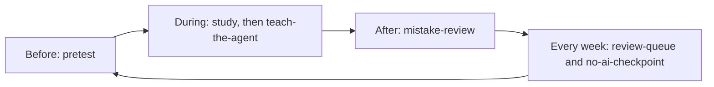
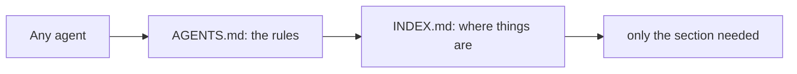

# Agents and skills

The agent is a tutor, not an answer machine. You try first, it gives hints one step at a time, you rate your confidence before it reveals anything, and it never writes your notes or answers for you. Practice with unguarded AI raises scores while you have it and lowers them once you don't; a guarded tutor largely avoids that (see `40_References/Guides/Studying_with_AI.md`).

A study session, with what to ask:

| When | Ask the agent | Skill |
|---|---|---|
| Starting something new | "Start a track for the book *X*, finishing in March" | `new-track` |
| Before a session | "Pretest me on session 3" | `pretest` |
| After reading | "I'll explain retrieval practice; list only my gaps" | `teach-the-agent` |
| After a quiz | "Turn today's mistakes into cards" | `mistake-review` |
| Any day | "What should I review today?" | `review-queue` |
| Before an interview, oral exam or conversation | "Run a 30-minute observed mock" | `spoken-mock` |
| Every two weeks | "Closed-book checkpoint on what I studied before the 1st" | `no-ai-checkpoint` |
| Building material | "Add a concept note on spacing", "process this paper", "save this page" | `new-concept-note`, `process-paper`, `process-web` |
| Before committing | "Run the checks" | `run-checks` |

Skills that write files run only when you ask. Claude Code and Cursor enforce it with `disable-model-invocation` in each skill, and Codex with `agents/openai.yaml` (`allow_implicit_invocation: false`). Other agents rely on the skill description, which asks for it. Agents also have the Obsidian skills from kepano/obsidian-skills (`obsidian-markdown`, `obsidian-bases`, `json-canvas`, `obsidian-cli`, `defuddle`) for writing Markdown, bases and canvases correctly.

## Supported agents

Every agent ends up at `AGENTS.md`, then `INDEX.md`, then only the section it needs:

Where each agent looks for its files. A dash means the vault does not use that file; it says nothing about the agent.

| Agent | Rules file | Skills | Hooks | MCP config | Ignore and permissions |
|---|---|---|---|---|---|
| Claude Code | `CLAUDE.md`, which imports `@AGENTS.md` | `.claude/skills` | `.claude/settings.json` | `.mcp.json` | `permissions.deny` and the sandbox |
| Codex | `AGENTS.md` | `.agents/skills` | `.codex/hooks.json` (trusted projects) | `.codex/config.toml` | `sandbox_mode` and deny-read rules |
| Antigravity CLI (`agy`) | `GEMINI.md` and `AGENTS.md` | `.agents/skills` | - | `.agents/mcp_config.json` | not documented |
| Gemini CLI | `GEMINI.md`, with `@` imports | `.gemini/skills` or `.agents/skills` | - | `.gemini/settings.json` | `.geminiignore` |
| GitHub Copilot | `AGENTS.md`; `.github/copilot-instructions.md` is a fallback | `.github/skills`, `.claude/skills` or `.agents/skills`, depending on the surface | - | `.vscode/mcp.json` | content exclusion in GitHub settings |
| Cursor | `AGENTS.md` | `.agents/skills` | - | - | `.cursorignore` (terminal and MCP tools bypass it) |
| OpenCode | `AGENTS.md` | `.agents/skills` | - | - | - |

- Claude Code reads `AGENTS.md` itself only when no `CLAUDE.md` exists, and it ignores `.agents/`. That is why `CLAUDE.md` imports `AGENTS.md` and `.claude/skills/` links to the folders in `.agents/skills/`.
- Since 2026-06-18, Gemini CLI is available only with enterprise licences and paid API keys.
- The vault ships the rules files, the skills, `.claude/settings.json`, `.cursorignore` and `.geminiignore`. The MCP and hook paths in the table are where each agent looks if you add your own.
- To check that an agent loaded the rules, ask it which rules file it loaded and what tutor mode means here.

| File | Purpose |
|---|---|
| `AGENTS.md` | The one rules file: how to read the vault, writing rules, tutor mode, safety, workflow |
| `CLAUDE.md`, `GEMINI.md`, `.github/copilot-instructions.md` | Point their agent to `AGENTS.md`, nothing else |
| `INDEX.md`, `90_System/index.json` | Generated map: one line per note, and every heading with its line number, so an agent opens only the section it needs |
| `llms.txt` | Optional index that follows the llms.txt convention; no major agent reads it automatically, so paste or link it when a tool needs a short map |
| `.agents/skills/` | The skills above; `.claude/skills/` links to the same folders |
| `.claude/settings.json` | Claude Code only: denies reading `.env` and plugin `data.json`, asks you before any edit in your own notes (`10_Tracks/`, `20_Concepts/`, `50_Review/`), formats every note an agent edits and rebuilds the index. Other agents rely on the rule in `AGENTS.md` and on `run-checks` |
| `.cursorignore`, `.geminiignore` | Keep `.env` files and plugin `data.json` out of Cursor and Gemini CLI context. A terminal command or a tool can still read them, so they lower the risk but do not remove it |

Agents send the notes they read to their provider. Keep private material out of a vault you open with a cloud agent, or use a local model (see [FAQ](FAQ.md)).
