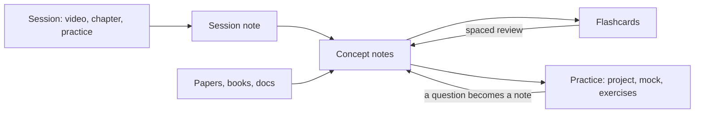

# Vault structure

## How the material flows

## Folders

| Path | Content |
|---|---|
| `00_Home.md` | Dashboard: tracks, today's review, bases |
| `00_Inbox/` | Quick captures, emptied in the weekly review |
| `10_Tracks/` | One folder per learning project: track note, `sessions/`, `practice/` |
| `20_Concepts/` | One note per concept, shared across tracks |
| `30_Maps/` | Canvases, one per track, drawn by `build_canvas.py` from the track's sessions and the concepts they link |
| `40_References/` | `Papers/`, `Books/`, `Repositories/`, `Web/`, `Guides/` (verified sources only) |
| `50_Review/` | Flashcard decks, glossaries and `Mistakes.md` (the mistakes log, with how AI was involved in each mistake) |
| `90_System/` | `Templates/` (including `Checkpoint.md`, `Debrief.md` and a practice kit per kind in `Practice/`), `Bases/` (including `Tracks.base`, `Weakest.base`, `Interleave.base`, `Blueprint.base` and `Progress.base`), `Specs/` (including `Track_kinds.md` and study layer translations), `Evals/` (a hand-run tutor-mode test), `Scripts/`, `Agent_Log/`, `index.json` |
| `INDEX.md` | Generated reading index for agents: one line per note |

Scripts, checks and automation are in [Tools and customization](Tools.md).
