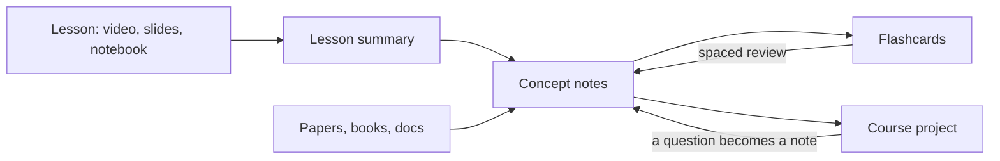

# How to study with this vault

> [!tldr] The idea in one line
> A lesson becomes a summary, the summary points to concepts, concepts gather theory and sources, flashcards make it stick and the project applies it. Every new course reuses the same concepts.

## 1. Three kinds of note

| Kind | Where | Purpose | Rule |
|---|---|---|---|
| Source | `40_References`, transcripts | raw material | do not edit, only cite |
| Lesson summary | `10_Courses/<course>/lessons` | what the lesson taught, in its order | one per lesson, links to concepts |
| Concept | `20_Concepts` | the idea, in your words | one idea per note, the title is the idea |

Maps (Home, course notes, canvases) only organize and link. They do not hold new content.

## 2. Routine per lesson (30 to 45 minutes)

1. Right after the lesson, write from memory for 5 minutes.
2. Fill the lesson summary from the template, linking every concept.
3. Create or extend concept notes with the `new-concept-note` skill or by hand.
4. Write 3 to 5 flashcards in your own words.

## 3. Spaced review

Every day: run "Spaced Repetition: Review flashcards from all notes". Every week: the weekly review template empties the inbox and checks what you remember without looking.

## 4. Using AI without losing the learning

The AI asks, hints and corrects; you recall, solve and explain. The evidence is in [[Studying_with_AI|Studying with AI]].

## 5. Plugins this vault expects

Core: Properties, Bases, Canvas, Graph, Templates, Backlinks, Outline. Community: Dataview, Spaced Repetition, Templater, Omnisearch, Kanban. Install them from Settings, Community plugins; the vault only lists them.
