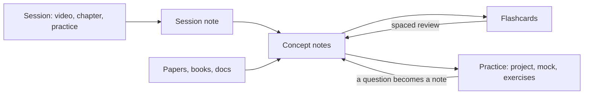

# How to study with this vault

> [!tldr] The idea in one line
> You learn through tracks. A session becomes a note, the note points to concepts, concepts gather theory and sources, flashcards make it stick and practice applies it. Every new track reuses the same concepts.

## 1. Tracks and three kinds of note

A track is one learning project: a course, a book, a certification, an interview, research, a skill or a language. Its note holds a goal, a done criterion you can fail, a deadline (or none, for an ongoing track) and one if-then plan. Each kind has a recipe for notes, practice, review and checkpoint in [[Track_kinds|Track kinds]]. The `new-track` skill builds the folder from it.

| Kind of note | Where | Purpose | Rule |
|---|---|---|---|
| Source | `40_References`, transcripts | raw material | do not edit, only cite |
| Session note | `10_Tracks/<track>/sessions` | what one study session taught, in its order | one per session, links to concepts |
| Concept | `20_Concepts` | the idea, in your words | one idea per note, the title is the idea |

Maps (Home, track notes, canvases) only organize and link. They do not hold new content. Folders stay shallow: structure lives in links, properties and the review loop.

## 2. Routine per session (30 to 45 minutes)

Every session follows plan, act, reflect.

1. Plan. Write one goal for the session. Fill the `Pretest` section: 3 to 5 questions, your guess for each, confidence from 1 to 5. The `pretest` skill can write the questions; the guesses are yours.
2. Act. Study, or practice, and take notes in the session note, linking every concept.
3. Right after, write from memory for 5 minutes in `Recall without notes`, then compare.
4. Reflect. What worked, what did not, what you change. Say whether the AI scaffolded (asked, hinted, checked) or substituted (did the work).
5. Create or extend concept notes with the `new-concept-note` skill or by hand.
6. Write 3 to 5 flashcards in your own words. Make at least one an apply card: a new situation, not the definition. Each card links its source.
7. Explain the concept to an agent with `teach-the-agent` and fix only the gaps it lists.
8. End with a next step as an if-then plan: "If ..., then I will ...".

## 3. Spaced review

Every day: run "Spaced Repetition: Review flashcards from all notes", and stop at 10 to 20 reviews with about 2 new cards. When more are due, use the "catch up backlog" mode: oldest and weakest first, no new cards until the queue is under the cap. A missed day costs nothing; count the days you studied, not a streak. Every week: the weekly review template empties the inbox and checks what you remember without looking.

Every two weeks, or when the Home page shows concepts not tested for 14 days, run a closed-book `no-ai-checkpoint`. Write the score you expect first, and compare it with the result; the gap is what to study. Include one concept explained without notes. The checkpoint logs `last_tested`, `score` and `confidence` on each concept. The Home bases `Weakest` and `Interleave` show what to review and mix topics. Wrong answers go to `50_Review/Mistakes.md`, and `mistake-review` turns them into corrected cards.

Those properties keep only the last result. The ledger keeps the whole history: every graded attempt is appended to `50_Review/Attempts.jsonl`, and `retention_report.py` shows what was retained after 7, 30 and 90 days, what was applied in a new task, and whether your confidence matched the result. The `record-attempt` skill writes one line after a session. From the same ledger come the plan for the day (`schedule_review.py`, weak and stale first, a wrong last attempt on top) and the list of what owes a delayed test (`retention_audit.py`). After a break of 14 days or more, `schedule_review.py --recovery` runs a short diagnostic instead of the whole queue.

The record also drives the session itself. `transfer_lab.py` finds the ideas you only repeated and asks for a case you have not seen. `misconception_report.py` finds the ones you keep getting wrong, so you can practise telling two similar ideas apart. `dependency_check.py` says what has to come first before a new concept. And `schedule_review.py --errors` gives the question you got wrong, in a new version, so you work with the idea and not with the sentence. The [spec](90_System/Evals/Learning_outcomes.md) says what counts and what does not, and the [interventions spec](90_System/Evals/Learning_interventions.md) says what each of these does and does not prove.

Do not sort yourself into a learning style. Match the method to the material.

## 4. Using AI without losing the learning

The AI asks, hints and corrects; you recall, solve and explain. This is tutor mode, and every skill here follows it:

- You attempt first, before the AI says anything about the content.
- Hints come in steps, only after an attempt: hint, strong hint, partial example, answer.
- You rate your confidence from 1 to 5 before the reveal.
- The AI never writes your study layer or your answers.

The evidence and the protocol are in [[Studying_with_AI|Studying with AI]].

## 5. Plugins this vault uses

Core: Properties, Bases, Canvas, Graph, Templates, Backlinks, Outline. Community (optional): Spaced Repetition, to review flashcards. Install it from Settings, Community plugins; the vault only lists it.
