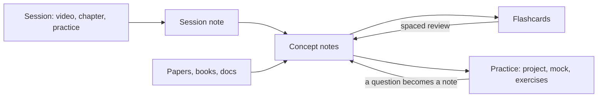
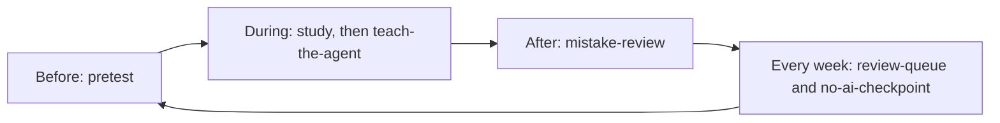
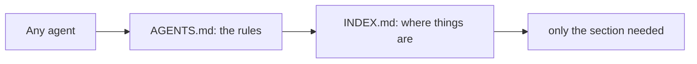

# Vault of Loci

[](https://github.com/erikunha/vault-of-loci/actions/workflows/checks.yml) [](LICENSE)


> The method of loci stores memories in places you know. This vault stores what you learn in notes you return to, with AI agents that quiz you instead of answering for you.

An Obsidian vault template to study anything with AI agents: a course, a book, a certification, an interview, research, a skill or a language. Each learning project is a track with a goal, a done criterion and a recipe for its kind. Every note is study material (a long explanation, key takeaways and flashcards), every source is verified, and automatic checks keep notes, links and names consistent. Claude Code, Codex, Antigravity CLI, Gemini CLI, Copilot, Cursor and OpenCode all follow the same rules from one `AGENTS.md`.

Plain Markdown. MIT licensed.

## Why

- **Notes you can study from**, not just an index: each concept, paper and guide carries a study layer and its own flashcards.
- **Built on learning science**: retrieval practice and spaced review, with a tutor-mode protocol for using AI without losing the learning: you attempt first, hints come in steps, you rate confidence before the reveal, and the agent never writes your study layer (see `40_References/Guides/Studying_with_AI.md`).
- **Any kind of learning project**: one recipe per kind (notes, practice, review cadence, checkpoint) in `90_System/Specs/Track_kinds.md`, plus rituals every track shares: plan, act, reflect each session, predict your score before a checkpoint, explain without notes, a daily review cap with a catch-up mode, and streaks that forgive missed days.
- **Agent-ready**: one rules file, project skills, a log of what each agent did, a hook that formats every note an agent writes, and a generated index (`INDEX.md` and `90_System/index.json`) so an agent reads only the section it needs.
- **Checked on every push**: formatting, broken links (including `obsidian://` links, `README.md` and `llms.txt`), the study layer, file names, flashcards (a source link on each card, no repeated question), skill files, the reading index and tests.

## How the material flows



## Quick start

1. Click **Use this template** on GitHub (or clone it) and open the folder as a vault in Obsidian. Obsidian 1.9 or later is required for Bases. The optional CLI skills (`review-queue`) need 1.12.7 or later with the app running.
2. Optional: install the Spaced Repetition community plugin (listed in `.obsidian/community-plugins.json`) to review flashcards. The vault needs no other plugin.
3. Read `How_to_Study_with_this_Vault.md`, then `00_Home.md`.
4. Create your first track with the `new-track` skill in Claude Code or Codex (it asks for the kind and the horizon), or copy `90_System/Templates/Track.md` into `10_Tracks/<NN>_<Name>/`.
5. Delete or keep the example tracks, concept and paper. They show the full note format.
6. Run the checks below. All of them should pass before you write your first note.

## Structure

| Path | Content |
|---|---|
| `00_Home.md` | Dashboard: tracks, today's review, bases |
| `00_Inbox/` | Quick captures, emptied in the weekly review |
| `10_Tracks/` | One folder per learning project: track note, `sessions/`, `practice/` |
| `20_Concepts/` | One note per concept, shared across tracks |
| `30_Maps/` | Canvases |
| `40_References/` | `Papers/`, `Books/`, `Repositories/`, `Web/`, `Guides/` (verified sources only) |
| `50_Review/` | Flashcard decks, glossaries and `Mistakes.md` (the mistakes log, with how AI was involved in each mistake) |
| `90_System/` | `Templates/` (including `Checkpoint.md`, `Debrief.md` and a practice kit per kind in `Practice/`), `Bases/` (including `Tracks.base`, `Weakest.base` and `Interleave.base`), `Specs/` (including `Track_kinds.md` and study layer translations), `Scripts/`, `Agent_Log/`, `index.json` |
| `INDEX.md` | Generated reading index for agents: one line per note |

## Naming standard

File and folder names use underscores instead of spaces (`Retrieval_Practice.md`). The title inside the note keeps spaces, and links show the readable name: `[[Retrieval_Practice|Retrieval practice]]`. To fix names created by hand (files and folders, deepest first; folders marked `.vendored` are skipped):

```bash
python3 90_System/Scripts/normalize_names.py          # dry run
python3 90_System/Scripts/normalize_names.py --write  # rename (git mv when tracked) and rewrite every link
```

## Export

Both scripts print a dry run unless you give them an output file.

```bash
python3 -I 90_System/Scripts/export_anki_tsv.py --out cards.tsv   # cards and clozes for Anki (File > Import), one deck per track
python3 -I 90_System/Scripts/export_bibtex.py --out refs.bib --csl-out refs.json   # reference notes for Zotero, Pandoc or LaTeX
```

## Checks

```bash
python3 -I 90_System/Scripts/format_notes.py --check                  # note spacing
python3 -I 90_System/Scripts/validation/check_links.py                # wikilinks, Markdown, obsidian://, llms.txt
python3 -I 90_System/Scripts/validation/check_study_layer.py          # study layer present and in order
python3 -I 90_System/Scripts/validation/check_names.py                # no spaces in names
python3 -I 90_System/Scripts/validation/check_cards.py                # card source link, no repeated question
python3 -I 90_System/Scripts/validation/check_skills.py               # skill files follow the Agent Skills spec
python3 -I 90_System/Scripts/validation/check_bases.py                # bases never list the templates
python3 -I 90_System/Scripts/validation/check_study_layer_translations.py   # translations keep the same keys
python3 -I 90_System/Scripts/validation/check_alt_text.py             # every image has alt text
python3 -I 90_System/Scripts/validation/check_index.py                # INDEX.md and index.json are current
python3 -I 90_System/Scripts/validation/test_format_notes.py
python3 -I 90_System/Scripts/validation/test_normalize_names.py
python3 -I 90_System/Scripts/validation/test_check_links.py
python3 -I 90_System/Scripts/validation/test_check_study_layer.py
python3 -I 90_System/Scripts/validation/test_check_cards.py
python3 -I 90_System/Scripts/validation/test_check_skills.py
python3 -I 90_System/Scripts/validation/test_check_bases.py
python3 -I 90_System/Scripts/validation/test_check_study_layer_translations.py
python3 -I 90_System/Scripts/validation/test_check_index.py
python3 -I 90_System/Scripts/validation/test_check_alt_text.py
python3 -I 90_System/Scripts/validation/test_export_anki_tsv.py
python3 -I 90_System/Scripts/validation/test_export_bibtex.py
```

The same set runs in `.github/workflows/checks.yml`. Python 3.10+ standard library only. If `check_index.py` fails, rebuild the index with `python3 -I 90_System/Scripts/build_index.py`; the Claude Code hook does it after each note edit.

## Customize

- **Language.** The study layer headings are set in one file, `90_System/Specs/study_layer.json`, which `check_study_layer.py` reads. A Portuguese version ships as `study_layer.pt-BR.json`: copy it over `study_layer.json` to switch. Change them there, then in the `Concept` and `Reference` templates, in `90_System/Specs/Study_layer.md` and in the existing notes. Note text can be in any language.
- **Track kinds.** Recipes live in `90_System/Specs/Track_kinds.md`; the `new-track` skill reads them. Edit a recipe or add a kind there.
- **Concept categories.** Each category is a `cat/<name>` tag with a color in `.obsidian/graph.json` and `.obsidian/snippets/study-vault.css`. Add or rename them in both places.
- **Folders.** The numbered top folders are referenced by `llms.txt`, the skills and the checks (the bases filter by the `type` property, not by folder). Rename one and run the checks to find what still points to the old name.
- **Agents.** Add rules to `AGENTS.md` only. `CLAUDE.md` and `GEMINI.md` stay as one import line. Add other secret paths to `.cursorignore`, `.geminiignore` and `.claude/settings.json`.

## Studying with an AI agent

The agent is a tutor, not an answer machine. You try first, it gives hints one step at a time, you rate your confidence before it reveals anything, and it never writes your notes or answers for you. Practice with unguarded AI raises scores while you have it and lowers them once you don't; a guarded tutor largely avoids that (see `40_References/Guides/Studying_with_AI.md`).

A study session, with what to ask:



| When | Ask the agent | Skill |
|---|---|---|
| Starting something new | "Start a track for the book *X*, finishing in March" | `new-track` |
| Before a session | "Pretest me on session 3" | `pretest` |
| After reading | "I'll explain retrieval practice; list only my gaps" | `teach-the-agent` |
| After a quiz | "Turn today's mistakes into cards" | `mistake-review` |
| Any day | "What should I review today?" | `review-queue` |
| Before an interview, oral exam or conversation | "Run a 30-minute observed mock" | `spoken-mock` |
| Every two weeks | "Closed-book checkpoint on what I studied before the 1st" | `no-ai-checkpoint` |
| Building material | "Add a concept note on spacing", "process this paper", "save this page" | `new-concept-note`, `process-paper`, `process-web` |
| Before committing | "Run the checks" | `run-checks` |

Skills that write files run only when you ask. Claude Code and Cursor enforce it with `disable-model-invocation` in each skill, and Codex with `agents/openai.yaml` (`allow_implicit_invocation: false`). Other agents rely on the skill description, which asks for it. Agents also have the Obsidian skills listed under Credits (`obsidian-markdown`, `obsidian-bases`, `json-canvas`, `obsidian-cli`, `defuddle`) for writing Markdown, bases and canvases correctly.

### Supported agents

Every agent ends up at `AGENTS.md`, then `INDEX.md`, then only the section it needs:



Where each agent looks for its files. A dash means the vault does not use that file; it says nothing about the agent.

| Agent | Rules file | Skills | Hooks | MCP config | Ignore and permissions |
|---|---|---|---|---|---|
| Claude Code | `CLAUDE.md`, which imports `@AGENTS.md` | `.claude/skills` | `.claude/settings.json` | `.mcp.json` | `permissions.deny` and the sandbox |
| Codex | `AGENTS.md` | `.agents/skills` | `.codex/hooks.json` (trusted projects) | `.codex/config.toml` | `sandbox_mode` and deny-read rules |
| Antigravity CLI (`agy`) | `GEMINI.md` and `AGENTS.md` | `.agents/skills` | - | `.agents/mcp_config.json` | not documented |
| Gemini CLI | `GEMINI.md`, with `@` imports | `.gemini/skills` or `.agents/skills` | - | `.gemini/settings.json` | `.geminiignore` |
| GitHub Copilot | `AGENTS.md`; `.github/copilot-instructions.md` is a fallback | `.github/skills`, `.claude/skills` or `.agents/skills`, depending on the surface | - | `.vscode/mcp.json` | content exclusion in GitHub settings |
| Cursor | `AGENTS.md` | `.agents/skills` | - | - | `.cursorignore` (terminal and MCP tools bypass it) |
| OpenCode | `AGENTS.md` | `.agents/skills` | - | - | - |

- Claude Code reads `AGENTS.md` itself only when no `CLAUDE.md` exists, and it ignores `.agents/`. That is why `CLAUDE.md` imports `AGENTS.md` and `.claude/skills/` links to the folders in `.agents/skills/`.
- Since 2026-06-18, Gemini CLI is available only with enterprise licences and paid API keys.
- The vault ships the rules files, the skills, `.claude/settings.json`, `.cursorignore` and `.geminiignore`. The MCP and hook paths in the table are where each agent looks if you add your own.
- To check that an agent loaded the rules, ask it which rules file it loaded and what tutor mode means here.

| File | Purpose |
|---|---|
| `AGENTS.md` | The one rules file: how to read the vault, writing rules, tutor mode, safety, workflow |
| `CLAUDE.md`, `GEMINI.md`, `.github/copilot-instructions.md` | Point their agent to `AGENTS.md`, nothing else |
| `INDEX.md`, `90_System/index.json` | Generated map: one line per note, and every heading with its line number, so an agent opens only the section it needs |
| `llms.txt` | Optional index that follows the llms.txt convention; no major agent reads it automatically, so paste or link it when a tool needs a short map |
| `.agents/skills/` | The skills above; `.claude/skills/` links to the same folders |
| `.claude/settings.json` | Claude Code only: denies reading `.env` and plugin `data.json`, formats every note an agent edits and rebuilds the index. Other agents rely on `run-checks` |
| `.cursorignore`, `.geminiignore` | Keep `.env` files and plugin `data.json` out of Cursor and Gemini CLI context. A terminal command or a tool can still read them, so they lower the risk but do not remove it |

Agents send the notes they read to their provider. Keep private material out of a vault you open with a cloud agent, or use a local model (see `FAQ.md`).

## Community

- [`CONTRIBUTING.md`](CONTRIBUTING.md): what fits, how to propose a change, the checks to run.
- [`FAQ.md`](FAQ.md): common questions about setup, updating your copy, privacy, offline use, plugins, language and agents.
- [`CHANGELOG.md`](CHANGELOG.md): what changed in each version.
- [`CODE_OF_CONDUCT.md`](CODE_OF_CONDUCT.md) and [`SECURITY.md`](SECURITY.md).
- Content is welcome: concept notes, references, guides, track recipes, example tracks, translations and skills. Use the "Content proposal" issue form.
- Help and maintainer: open an issue on GitHub. The maintainer is [@erikunha](https://github.com/erikunha).

## Contributors

- [@erikunha](https://github.com/erikunha): maintainer.

## Credits

- Agent skills in folders marked `.vendored` come from [kepano/obsidian-skills](https://github.com/kepano/obsidian-skills) (MIT, copyright Steph Ango). Each folder keeps its `LICENSE`.

## License

MIT. See `LICENSE`.
