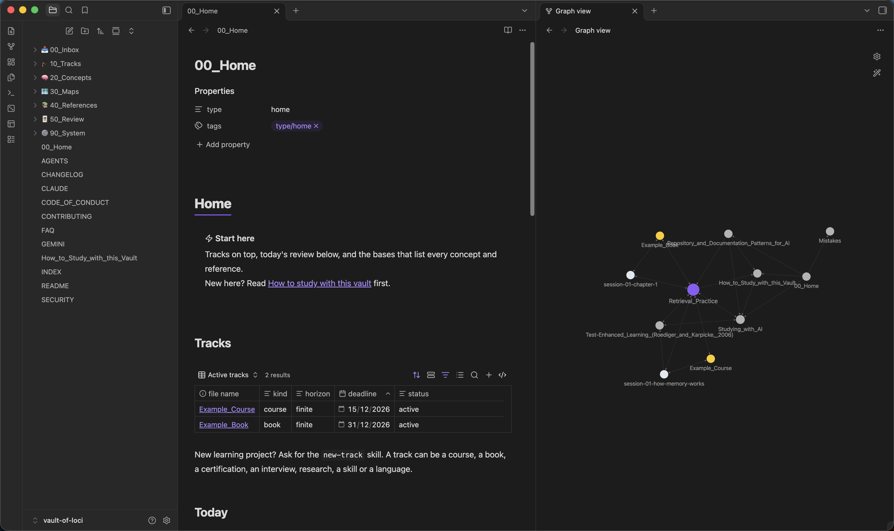
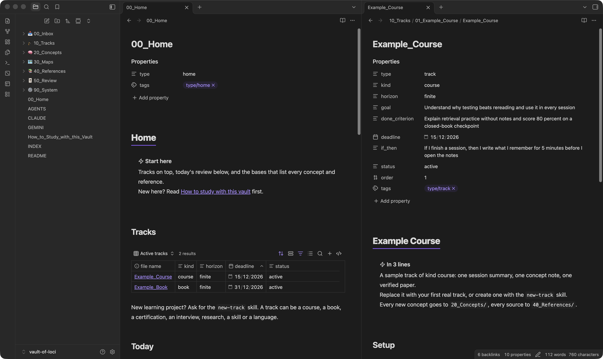
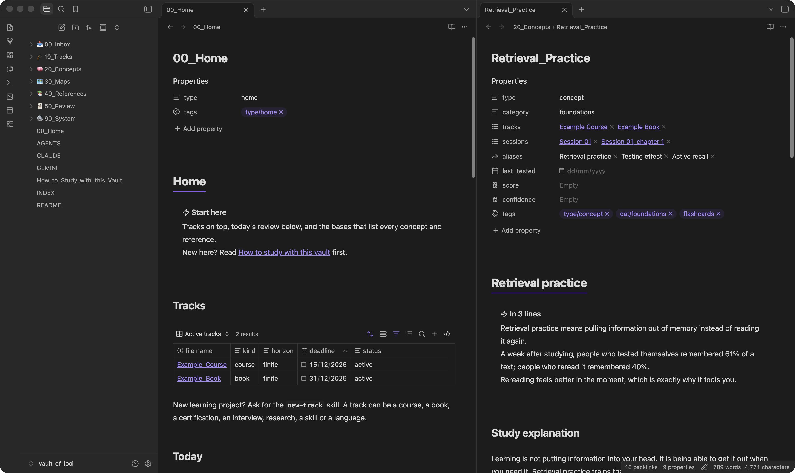

# Vault of Loci

[](LICENSE) [](https://github.com/erikunha/vault-of-loci/actions/workflows/checks.yml) [](https://github.com/erikunha/vault-of-loci/releases) [](.github/CONTRIBUTING.md)

Vault of Loci is an Obsidian vault template for learning anything with AI agents that quiz you instead of answering for you.

* **Same `AGENTS.md`, any agent or provider.** Claude Code, Codex, Antigravity CLI, Gemini CLI, Copilot, Cursor and OpenCode read the same rules from one file, and your notes and progress are plain files, so you can switch agent or model, including local ones, without starting over.
* **A tutor, not an answer machine:** you attempt first, hints come one step at a time, you rate your confidence before the reveal, and the agent never writes your notes. Practice with unguarded AI raises scores while you have it and lowers them once you don't; a guarded tutor largely avoids that.
* **Notes you can study from:** every concept, paper and guide carries a long explanation, key takeaways and flashcards with a source on each card. Every reference says whether it was verified, and checks on every push keep notes, links and names consistent.
* **Any learning project:** a course, a book, a certification, an interview, research, a skill or a language, each with its own recipe.

[Learn how to study with this vault](How_to_Study_with_this_Vault.md).

## Test the rules with your own agent

The tutor rules are a request, not a guarantee, so the repo has a test of 17 scenarios you can run against any agent. It keeps the whole transcript, and the score comes from a model of another family, never from the agent that answered.

```bash
python3 -I 90_System/Scripts/run_tutor_eval.py --label my-agent --agent-family my-family --agent-cmd "my-agent -p"
```

Add `--judge-cmd` with a command from another model family to score the run, or score it by hand with `scoring_sheet.md`. The results of the runs kept here are in [Tutor mode eval results](90_System/Evals/Tutor_mode_results.md): two agents, one run of the seventeen scenarios each, scored by two judges of two other families.

## Measure what you keep

The tutor test checks the agent. A second record checks the learning. Every graded attempt is appended to `50_Review/Attempts.jsonl`, so the whole history survives, and the report shows what was retained after 7, 30 and 90 days, what was applied in a task never seen before, and whether your confidence matched the result.

```bash
python3 -I 90_System/Scripts/record_attempt.py --objective retrieval-practice-recall \
  --item retrieval-practice-recall-01 --mode recall --correct --confidence 4
python3 -I 90_System/Scripts/retention_report.py
```

Attempts with help and attempts graded by an agent stay in the ledger but leave the rates, and the report says so. A forecast is never shown as a measurement. The [spec](90_System/Evals/Learning_outcomes.md) has the schema, the metrics and the reasons behind each choice.

From the same ledger come the two things the vault does next: a plan for today and a list of what is due.

```bash
python3 -I 90_System/Scripts/schedule_review.py        # what to review now, and why
python3 -I 90_System/Scripts/retention_audit.py         # what passed 7, 30 or 90 days without a test
```

The plan ranks by how weak and how stale each item is, and a mistake that was never recovered comes first. The audit names the objectives whose delay has arrived and still has nothing measured, so a new task can be written for them. The [interventions spec](90_System/Evals/Learning_interventions.md) explains each one and says what it does not prove.

From the same record come the four things a study session does with it: a transfer task for an idea you only repeated, a drill for the two ideas you keep mixing, a worked example when the record is empty, and a variation of the question you got wrong.

```bash
python3 -I 90_System/Scripts/transfer_lab.py         # the objectives that were studied and never applied
python3 -I 90_System/Scripts/misconception_report.py # the objectives that were wrong more than once
python3 -I 90_System/Scripts/dependency_check.py     # what has to come first, and where the gap is
python3 -I 90_System/Scripts/schedule_review.py --errors   # the items whose mistake was never recovered
```

Five more interventions come out of the same record. The calibration coach shows how well your confidence tracks the result. The memory palace turns ordered material into a route of places you pick. The visual reconstruction names the relations your drawing lost. The counterfactual asks what changes if one premise of a concept were false, and the compression challenge asks for the same idea three times, so you can see which relations survived.

```bash
python3 -I 90_System/Scripts/calibration_coach.py        # how well confidence tracks the result, with the sharpest cases
python3 -I 90_System/Scripts/palace_test.py --palace 50_Review/Palaces/<Name>.md   # the route of a palace note, with the item blank
```

## Test whether the agent measures the learning, not only the rules

The tutor test asks whether the agent behaves as a tutor. A second benchmark asks whether it uses the learner's own record: it reads the ledger, picks the objective that is really due, writes a task the learner has not seen, and never states a measurement it did not make.

```bash
python3 -I 90_System/Scripts/run_tutor_eval.py --benchmark learning --agent-cmd "my-agent -p" \
  --label my-agent --agent-family my-family --judge-cmd "other-agent -p" --judge-family other-family
```

Its 15 scenarios are in [Learning_evals.md](90_System/Evals/Learning_evals.md), with the transcripts of the runs kept here.

## Screenshots







## Installation

1. Click **Use this template** on GitHub (or clone it), or download `vault-of-loci-blank-<version>.zip` from the [latest release](https://github.com/erikunha/vault-of-loci/releases/latest) for a copy without the example tracks. Open the folder as a vault in Obsidian 1.9 or later.
2. Ask your agent for a new track with the `new-track` skill (Claude Code or Codex ask for the kind and the horizon), or copy `90_System/Templates/Track.md` into `10_Tracks/<NN>_<Name>/`.
3. Open `00_Home.md` and study. Keep a short study log each day with the core Daily notes command.

Optional: the Spaced Repetition community plugin (listed in `.obsidian/community-plugins.json`) reviews the flashcards, and the CLI skills (`review-queue`) need Obsidian 1.12.7 or later with the app running. The example tracks, concept and paper show the full note format; keep or delete them. `python3 -I 90_System/Scripts/run_checks.py` checks the vault after you change it.

## Documentation

The documentation lives in the vault, so it travels with your copy:

* [How to study with this vault](How_to_Study_with_this_Vault.md): the method, step by step
* [Studying with AI](40_References/Guides/Studying_with_AI.md): the tutor-mode protocol and the evidence behind it
* [Agents and skills](90_System/Specs/Agents.md): what to ask at each step, and where each agent finds its rules
* [Vault structure](90_System/Specs/Vault_structure.md): what each folder holds and how material flows
* [Track kinds](90_System/Specs/Track_kinds.md): one recipe per kind of learning project
* [Study layer](90_System/Specs/Study_layer.md): the format of every study note
* [Tools and customization](90_System/Specs/Tools.md): scripts, checks, automation, and how to change language, kinds and folders
* [Tutor mode evaluation](90_System/Evals/Tutor_mode.md): a test, by hand or with a script that runs any agent and keeps transcripts, of whether your agent behaves as a tutor
* [FAQ](90_System/Specs/FAQ.md): setup, updating your copy, privacy, offline use, plugins and language

## Contributing

Content is welcome, and you do not need to write code: concept notes, verified references, guides, track recipes, example tracks, translations and skills all help. Read the [contributing guide](.github/CONTRIBUTING.md) to learn what fits and how to propose a change, start with a [good first issue](https://github.com/erikunha/vault-of-loci/labels/good%20first%20issue), and ask questions with the [Question form](https://github.com/erikunha/vault-of-loci/issues/new?template=question.yml). Everyone who takes part follows the [Code of Conduct](.github/CODE_OF_CONDUCT.md). Report security problems as [`SECURITY.md`](.github/SECURITY.md) explains.

## License

Vault of Loci is [MIT licensed](LICENSE). Agent skills in folders marked `.vendored` come from [kepano/obsidian-skills](https://github.com/kepano/obsidian-skills) (MIT, copyright Steph Ango); each folder keeps its `LICENSE`.
