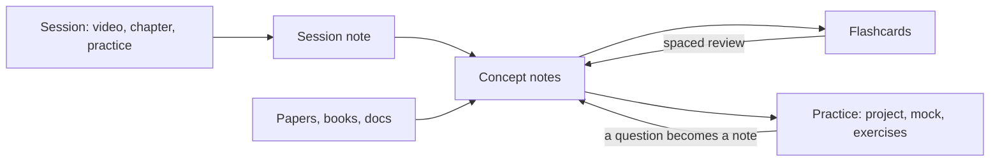
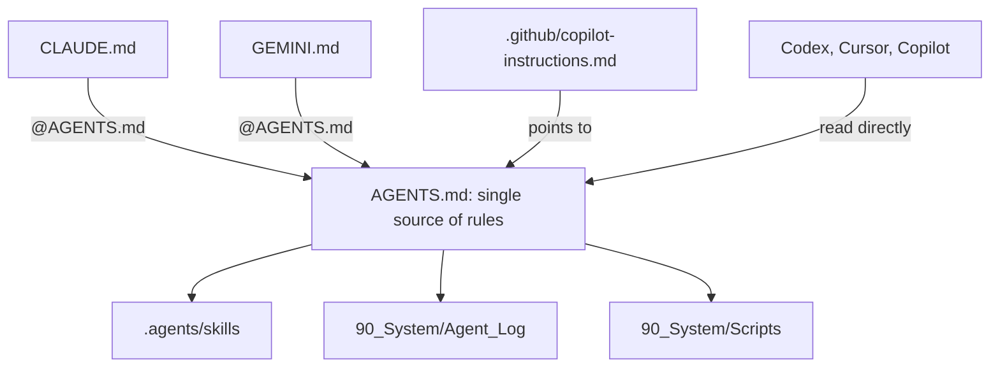

# Vault of Loci

[](https://github.com/erikunha/vault-of-loci/actions/workflows/checks.yml) [](LICENSE)

> The method of loci stores memories in places you know. This vault stores what you learn in notes you return to, with AI agents that quiz you instead of answering for you.

An Obsidian vault template to study anything with AI agents: a course, a book, a certification, an interview, research, a skill or a language. Each learning project is a track with a goal, a done criterion and a recipe for its kind. Every note is study material (a long explanation, key takeaways and flashcards), every source is verified, and automatic checks keep notes, links and names consistent. Claude Code, Codex, Gemini CLI and Copilot all follow the same rules from one `AGENTS.md`.

Plain Markdown. MIT licensed.

## Why

- **Notes you can study from**, not just an index: each concept, paper and guide carries a study layer and its own flashcards.
- **Built on learning science**: retrieval practice and spaced review, with a tutor-mode protocol for using AI without losing the learning: you attempt first, hints come in steps, you rate confidence before the reveal, and the agent never writes your study layer (see `40_References/Guides/Studying_with_AI.md`).
- **Any kind of learning project**: one recipe per kind (notes, practice, review cadence, checkpoint) in `90_System/Specs/Track_kinds.md`, plus rituals every track shares: plan, act, reflect each session, predict your score before a checkpoint, explain without notes, a daily review cap with a catch-up mode, and streaks that forgive missed days.
- **Agent-ready**: one rules file, project skills, a log of what each agent did, a hook that formats every note an agent writes, and a generated index (`INDEX.md` and `90_System/index.json`) so an agent reads only the section it needs.
- **Checked on every push**: formatting, broken links (including `obsidian://` links, `README.md` and `llms.txt`), the study layer, file names, flashcards (a source link on each card, no repeated question), skill files, the reading index and tests.

## How the material flows



## Quick start

1. Click **Use this template** on GitHub (or clone it) and open the folder as a vault in Obsidian. Obsidian 1.9 or later is required for Bases. The optional CLI skills (`review-queue`) need 1.12.7 or later with the app running.
2. Optional: install the Spaced Repetition community plugin (listed in `.obsidian/community-plugins.json`) to review flashcards. The vault needs no other plugin.
3. Read `How_to_Study_with_this_Vault.md`, then `00_Home.md`.
4. Create your first track with the `new-track` skill in Claude Code or Codex (it asks for the kind and the horizon), or copy `90_System/Templates/Track.md` into `10_Tracks/<NN>_<Name>/`.
5. Delete or keep the example tracks, concept and paper. They show the full note format.
6. Run the checks below. All of them should pass before you write your first note.

## Structure

| Path | Content |
|---|---|
| `00_Home.md` | Dashboard: tracks, today's review, bases |
| `00_Inbox/` | Quick captures, emptied in the weekly review |
| `10_Tracks/` | One folder per learning project: track note, `sessions/`, `practice/` |
| `20_Concepts/` | One note per concept, shared across tracks |
| `30_Maps/` | Canvases |
| `40_References/` | `Papers/`, `Books/`, `Repositories/`, `Web/`, `Guides/` (verified sources only) |
| `50_Review/` | Flashcard decks, glossaries and `Mistakes.md` (the mistakes log) |
| `90_System/` | `Templates/` (including `Checkpoint.md`), `Bases/` (including `Tracks.base`, `Weakest.base` and `Interleave.base`), `Specs/` (including `Track_kinds.md`), `Scripts/`, `Agent_Log/`, `index.json` |
| `INDEX.md` | Generated reading index for agents: one line per note |

## Naming standard

File and folder names use underscores instead of spaces (`Retrieval_Practice.md`). The title inside the note keeps spaces, and links show the readable name: `[[Retrieval_Practice|Retrieval practice]]`. To fix names created by hand (files and folders, deepest first; folders marked `.vendored` are skipped):

```bash
python3 90_System/Scripts/normalize_names.py          # dry run
python3 90_System/Scripts/normalize_names.py --write  # rename (git mv when tracked) and rewrite every link
```

## Checks

```bash
python3 -I 90_System/Scripts/format_notes.py --check                  # note spacing
python3 -I 90_System/Scripts/validation/check_links.py                # wikilinks, Markdown, obsidian://, llms.txt
python3 -I 90_System/Scripts/validation/check_study_layer.py          # study layer present and in order
python3 -I 90_System/Scripts/validation/check_names.py                # no spaces in names
python3 -I 90_System/Scripts/validation/check_cards.py                # card source link, no repeated question
python3 -I 90_System/Scripts/validation/check_skills.py               # skill files follow the Agent Skills spec
python3 -I 90_System/Scripts/validation/check_index.py                # INDEX.md and index.json are current
python3 -I 90_System/Scripts/validation/test_format_notes.py
python3 -I 90_System/Scripts/validation/test_normalize_names.py
python3 -I 90_System/Scripts/validation/test_check_links.py
python3 -I 90_System/Scripts/validation/test_check_study_layer.py
python3 -I 90_System/Scripts/validation/test_check_cards.py
python3 -I 90_System/Scripts/validation/test_check_skills.py
python3 -I 90_System/Scripts/validation/test_check_index.py
```

The same set runs in `.github/workflows/checks.yml`. Python 3.10+ standard library only. If `check_index.py` fails, rebuild the index with `python3 -I 90_System/Scripts/build_index.py`; the Claude Code hook does it after each note edit.

## Customize

- **Language.** The study layer headings are set in one file, `90_System/Specs/study_layer.json`, which `check_study_layer.py` reads. Change them there, then in the `Concept` and `Reference` templates, in `90_System/Specs/Study_layer.md` and in the existing notes. Note text can be in any language.
- **Track kinds.** Recipes live in `90_System/Specs/Track_kinds.md`; the `new-track` skill reads them. Edit a recipe or add a kind there.
- **Concept categories.** Each category is a `cat/<name>` tag with a color in `.obsidian/graph.json` and `.obsidian/snippets/study-vault.css`. Add or rename them in both places.
- **Folders.** The numbered top folders are referenced by `llms.txt`, the skills and the checks (the bases filter by the `type` property, not by folder). Rename one and run the checks to find what still points to the old name.
- **Agents.** Add rules to `AGENTS.md` only. `CLAUDE.md` and `GEMINI.md` stay as one import line.

## Working with AI agents



| File | Read by |
|---|---|
| `AGENTS.md` | Every agent: how to read the vault, writing rules, tutor mode, safety, workflow |
| `CLAUDE.md`, `GEMINI.md` | Import `@AGENTS.md` only |
| `.github/copilot-instructions.md` | Copilot; points to `AGENTS.md` |
| `llms.txt` | Any LLM, as an index |
| `INDEX.md`, `90_System/index.json` | Generated: one line per note, and the headings of every note with line numbers, so an agent opens only the section it needs |
| `.agents/skills/` | Own: `new-track`, `new-concept-note`, `process-paper`, `process-web`, `run-checks`, tutor mode: `pretest`, `no-ai-checkpoint`, `teach-the-agent`, `mistake-review`, `review-queue`. From kepano/obsidian-skills: `obsidian-markdown`, `obsidian-bases`, `json-canvas`, `obsidian-cli`, `defuddle` |
| `.claude/settings.json` | Blocks reading `.env` and plugin `data.json`; formats every note an agent edits and rebuilds the index |

## Community

- [`CONTRIBUTING.md`](CONTRIBUTING.md): what fits, how to propose a change, the checks to run.
- [`FAQ.md`](FAQ.md): common questions about setup, updating your copy, privacy, offline use, plugins, language and agents.
- [`CHANGELOG.md`](CHANGELOG.md): what changed in each version.
- [`CODE_OF_CONDUCT.md`](CODE_OF_CONDUCT.md) and [`SECURITY.md`](SECURITY.md).
- Help and maintainer: open an issue on GitHub. The maintainer is [@erikunha](https://github.com/erikunha).

## Credits

- Agent skills in folders marked `.vendored` come from [kepano/obsidian-skills](https://github.com/kepano/obsidian-skills) (MIT, copyright Steph Ango). Each folder keeps its `LICENSE`.

## License

MIT. See `LICENSE`.
