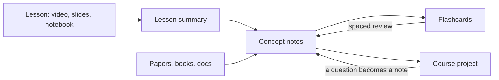
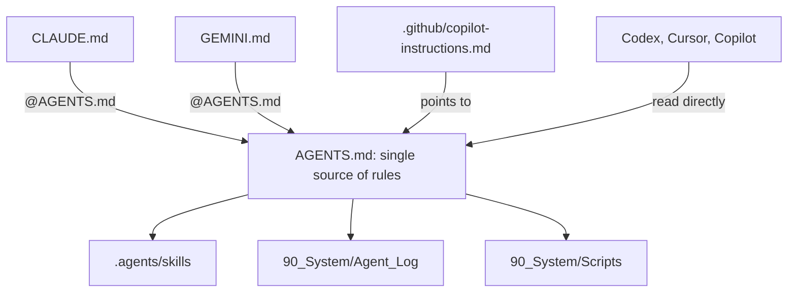

# Vault of Loci

[](https://github.com/erikunha/vault-of-loci/actions/workflows/checks.yml) [](LICENSE)

> The method of loci stores memories in places you know. This vault stores what you study in notes you return to, with AI agents that quiz you instead of answering for you.

An Obsidian vault template for studying courses with AI agents. Every note is study material (a long explanation, key takeaways and flashcards), every source is verified, and automatic checks keep notes, links and names consistent. Claude Code, Codex, Gemini CLI and Copilot all follow the same rules from one `AGENTS.md`.

Plain Markdown. MIT licensed.

## Why

- **Notes you can study from**, not just an index: each concept, paper and guide carries a study layer and its own flashcards.
- **Built on learning science**: retrieval practice and spaced review, with a protocol for using AI without losing the learning (see `40_References/Guides/Studying_with_AI.md`).
- **Agent-ready**: one rules file, project skills, a log of what each agent did, and a hook that formats every note an agent writes.
- **Checked on every push**: formatting, broken links (including `obsidian://` links to a sibling vault, `README.md` and `llms.txt`), the study layer, file names and tests.

## How the material flows



## Quick start

1. Click **Use this template** on GitHub (or clone it) and open the folder as a vault in Obsidian 1.9 or later (Bases is required).
2. Optional: install the Spaced Repetition community plugin (listed in `.obsidian/community-plugins.json`) to review flashcards. The vault needs no other plugin.
3. Read `How_to_Study_with_this_Vault.md`, then `00_Home.md`.
4. Create your first course with the `new-course` skill in Claude Code or Codex, or copy `90_System/Templates/Course.md` into `10_Courses/01_<Course_Name>/`.
5. Delete or keep the example course, concept and paper. They show the full note format.
6. Run the checks below. All of them should pass before you write your first note.

## Structure

| Path | Content |
|---|---|
| `00_Home.md` | Dashboard: courses, today's review, bases |
| `00_Inbox/` | Quick captures, emptied in the weekly review |
| `10_Courses/` | One folder per course: course note, `lessons/`, `project/` |
| `20_Concepts/` | One note per concept, shared across courses |
| `30_Maps/` | Canvases |
| `40_References/` | `Papers/`, `Books/`, `Repositories/`, `Web/`, `Guides/` (verified sources only) |
| `50_Review/` | Flashcard decks and glossaries |
| `90_System/` | `Templates/`, `Bases/`, `Specs/`, `Scripts/`, `Agent_Log/` |

## Naming standard

File and folder names use underscores instead of spaces (`Retrieval_Practice.md`). The title inside the note keeps spaces, and links show the readable name: `[[Retrieval_Practice|Retrieval practice]]`. To fix names created by hand (files and folders, deepest first; folders marked `.vendored` are skipped):

```bash
python3 90_System/Scripts/normalize_names.py          # dry run
python3 90_System/Scripts/normalize_names.py --write  # rename (git mv when tracked) and rewrite every link
```

## Checks

```bash
python3 -I 90_System/Scripts/format_notes.py --check                  # note spacing
python3 -I 90_System/Scripts/validation/check_links.py                # wikilinks, Markdown, obsidian://, llms.txt
python3 -I 90_System/Scripts/validation/check_study_layer.py          # study layer present and in order
python3 -I 90_System/Scripts/validation/check_names.py                # no spaces in names
python3 -I 90_System/Scripts/validation/test_format_notes.py
python3 -I 90_System/Scripts/validation/test_normalize_names.py
python3 -I 90_System/Scripts/validation/test_check_links.py
python3 -I 90_System/Scripts/validation/test_check_study_layer.py
```

The same set runs in `.github/workflows/checks.yml`. Python 3.10+ standard library only.

## Customize

- **Language.** The study layer headings (`## Study explanation`, `## Key takeaways`) are matched by `90_System/Scripts/validation/check_study_layer.py`. Change them there, in `90_System/Specs/Study_layer.md`, in the `Concept` and `Reference` templates and in `AGENTS.md`, then rename the headings in existing notes. Note text can be in any language.
- **Concept categories.** Each category is a `cat/<name>` tag with a color in `.obsidian/graph.json` and `.obsidian/snippets/study-vault.css`. Add or rename them in both places.
- **Folders.** The numbered top folders are referenced by `AGENTS.md`, `llms.txt` and the checks (the bases filter by the `type` property, not by folder). Rename one and run the checks to find what still points to the old name.
- **Agents.** Add rules to `AGENTS.md` only. `CLAUDE.md` and `GEMINI.md` stay as one import line.

## Working with AI agents



| File | Read by |
|---|---|
| `AGENTS.md` | Every agent: structure, writing rules, safety, workflow |
| `CLAUDE.md`, `GEMINI.md` | Import `@AGENTS.md` only |
| `.github/copilot-instructions.md` | Copilot; points to `AGENTS.md` |
| `llms.txt` | Any LLM, as an index |
| `.agents/skills/` | Own: `new-course`, `new-concept-note`, `process-paper`, `run-checks`. From kepano/obsidian-skills: `obsidian-markdown`, `obsidian-bases`, `json-canvas`, `obsidian-cli`, `defuddle` |
| `.claude/settings.json` | Blocks reading `.env` and plugin `data.json`; formats every note an agent edits |

## Community

- [`CONTRIBUTING.md`](CONTRIBUTING.md): what fits, how to propose a change, the checks to run.
- [`FAQ.md`](FAQ.md): common questions about setup, plugins, language and agents.
- [`CHANGELOG.md`](CHANGELOG.md): what changed in each version.
- [`CODE_OF_CONDUCT.md`](CODE_OF_CONDUCT.md) and [`SECURITY.md`](SECURITY.md).
- Help and maintainer: open an issue on GitHub. The maintainer is [@erikunha](https://github.com/erikunha).

## Credits

- Agent skills in folders marked `.vendored` come from [kepano/obsidian-skills](https://github.com/kepano/obsidian-skills) (MIT, copyright Steph Ango). Each folder keeps its `LICENSE`.

## License

MIT. See `LICENSE`.
