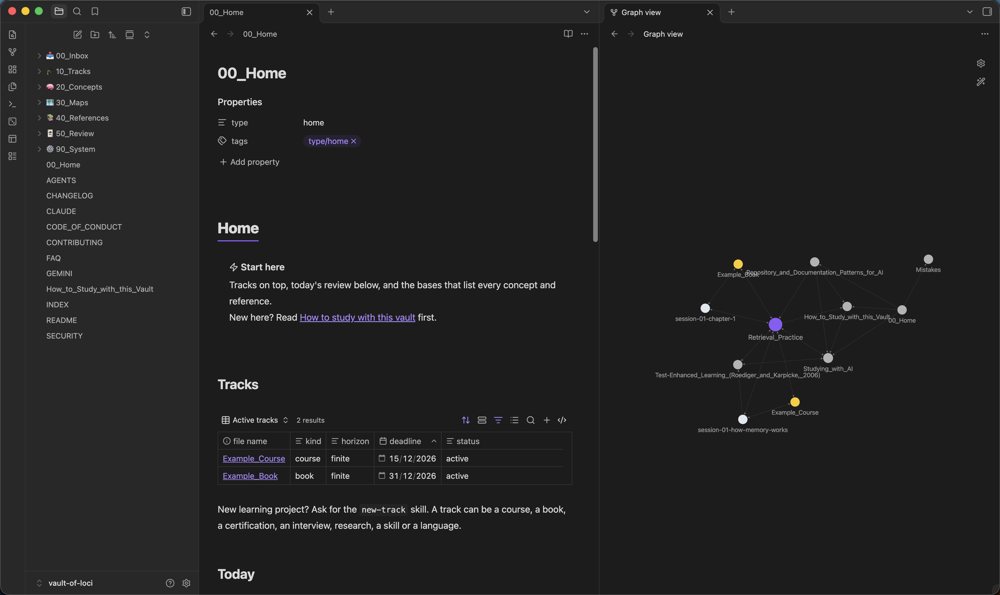

# Vault of Loci &middot; [](LICENSE) [](https://github.com/erikunha/vault-of-loci/actions/workflows/checks.yml) [](https://github.com/erikunha/vault-of-loci/releases) [](.github/CONTRIBUTING.md)

[English](README.md) · **Português**

Vault of Loci é um template de vault do Obsidian para aprender qualquer coisa com agentes de IA que perguntam em vez de responder por você.

* **Um tutor, não uma máquina de respostas:** você tenta primeiro, as pistas vêm um passo por vez, você dá sua confiança antes da revelação, e o agente nunca escreve suas notas. Praticar com IA sem limites sobe a nota enquanto você a tem e derruba quando ela some; um tutor com limites evita isso em grande parte.
* **Notas para estudar:** cada conceito, paper e guia traz uma explicação longa, pontos principais e flashcards com fonte em cada cartão. Toda referência é conferida, e checagens a cada push mantêm notas, links e nomes consistentes.
* **Qualquer projeto de estudo, qualquer agente:** um curso, um livro, uma certificação, uma entrevista, uma pesquisa, uma habilidade ou um idioma, cada um com sua receita. Claude Code, Codex, Antigravity CLI, Gemini CLI, Copilot, Cursor e OpenCode seguem as mesmas regras de um único `AGENTS.md`.

[Aprenda a estudar com este vault](How_to_Study_with_this_Vault.md) (em inglês).



## Instalação

1. Clique em **Use this template** no GitHub (ou clone) e abra a pasta como vault no Obsidian 1.9 ou mais novo.
2. Peça ao seu agente uma trilha nova com a skill `new-track` (o Claude Code ou o Codex perguntam o tipo e o horizonte), ou copie `90_System/Templates/Track.md` para `10_Tracks/<NN>_<Name>/`.
3. Abra `00_Home.md` e estude.

Opcional: o plugin da comunidade Spaced Repetition (listado em `.obsidian/community-plugins.json`) revisa os flashcards, e as skills de CLI (`review-queue`) pedem o Obsidian 1.12.7 ou mais novo, com o app aberto. As trilhas, o conceito e o paper de exemplo mostram o formato completo das notas; mantenha ou apague. O `python3 -I 90_System/Scripts/run_checks.py` confere o vault depois que você o muda.

## Documentação

A documentação fica no próprio vault, então vai junto com a sua cópia (em inglês):

* [Como estudar com este vault](How_to_Study_with_this_Vault.md): o método, passo a passo
* [Estudar com IA](40_References/Guides/Studying_with_AI.md): o protocolo do modo tutor e a evidência por trás dele
* [Agentes e skills](90_System/Specs/Agents.md): o que pedir em cada etapa, e onde cada agente acha suas regras
* [Estrutura do vault](90_System/Specs/Vault_structure.md): o que cada pasta guarda e como o material circula
* [Tipos de trilha](90_System/Specs/Track_kinds.md): uma receita por tipo de projeto de estudo
* [Camada de estudo](90_System/Specs/Study_layer.md): o formato de toda nota de estudo
* [Ferramentas e personalização](90_System/Specs/Tools.md): scripts, checagens, automação, e como mudar idioma, tipos e pastas
* [Avaliação do modo tutor](90_System/Evals/Tutor_mode.md): um teste feito à mão para ver se o seu agente se comporta como tutor
* [FAQ](.github/FAQ.md): instalação, atualizar sua cópia, privacidade, uso offline, plugins e idioma

## Exemplos

Pergunte "What is retrieval practice? Just tell me." e um agente que segue o `AGENTS.md` responde assim:

```text
Agente: Antes de explicar: o que você acha que é? Um chute em uma linha basta.
Aluno:  Reler muito as anotações?
Agente: Tem a ver com estudar, mas não é isso. Pista: é sobre o que você faz sem as anotações.
        Quanta certeza você tem da próxima resposta, de 1 (chute) a 5 (certeza)?
```

Esse é o comportamento que a [avaliação do modo tutor](90_System/Evals/Tutor_mode.md) confere, não uma sessão gravada. Rode a avaliação para ver o que o seu agente faz. Duas trilhas de exemplo em `10_Tracks/`, o conceito `20_Concepts/Retrieval_Practice.md` e uma nota de paper mostram o formato completo.

## Contribuir

Conteúdo é bem-vindo, e não é preciso programar: notas de conceito, referências conferidas, guias, receitas de trilha, trilhas de exemplo, traduções e skills ajudam. Contribuições são em inglês. Veja abaixo como participar.

### [Código de Conduta](.github/CODE_OF_CONDUCT.md)

Quem participa segue o [Código de Conduta](.github/CODE_OF_CONDUCT.md). Problemas de segurança vão em privado, como o [`SECURITY.md`](.github/SECURITY.md) explica.

### [Guia de Contribuição](.github/CONTRIBUTING.md)

Leia o [guia de contribuição](.github/CONTRIBUTING.md) para saber o que cabe, como propor uma mudança, como fazer uma primeira contribuição toda pelo editor do GitHub no navegador, e a política para contribuições feitas com IA.

### [Good First Issues](https://github.com/erikunha/vault-of-loci/labels/good%20first%20issue)

Para conhecer o processo, comece por uma [good first issue](https://github.com/erikunha/vault-of-loci/labels/good%20first%20issue): tarefas pequenas e bem delimitadas, como uma nota de conceito ou uma tradução.

### [Perguntas e Suporte](https://github.com/erikunha/vault-of-loci/discussions)

Pergunte em [Discussions](https://github.com/erikunha/vault-of-loci/discussions) depois de olhar o [FAQ](.github/FAQ.md); pode perguntar em português. O [`SUPPORT.md`](.github/SUPPORT.md) diz para onde vai cada tipo de pergunta. Os [Releases](https://github.com/erikunha/vault-of-loci/releases) listam o que mudou em cada versão e quem contribuiu pela primeira vez.

### Contribuidores

Toda ajuda conta, não só código: conteúdo, tradução, revisão, ideias, relato de bug. Quem faz commit entra sozinho; para o resto, abra uma issue ou discussão e você entra à mão no `.all-contributorsrc`. Cada emoji é um tipo de contribuição ([legenda](https://allcontributors.org/docs/en/emoji-key)).

<!-- ALL-CONTRIBUTORS-LIST:START - Do not remove or modify this section -->
<!-- prettier-ignore-start -->
<!-- markdownlint-disable -->
<table>
  <tbody>
    <tr>
      <td align="center" valign="top" width="14.29%"><a href="https://erikunha.dev"><br /><sub><b>Erik Cunha</b></sub></a><br /><a href="https://github.com/erikunha/vault-of-loci/commits?author=erikunha" title="Maintenance">🚧</a> <a href="https://github.com/erikunha/vault-of-loci/commits?author=erikunha" title="Code">💻</a> <a href="https://github.com/erikunha/vault-of-loci/commits?author=erikunha" title="Content">🖋</a> <a href="https://github.com/erikunha/vault-of-loci/commits?author=erikunha" title="Documentation">📖</a> <a href="https://github.com/erikunha/vault-of-loci/commits?author=erikunha" title="Research">🔬</a> <a href="https://github.com/erikunha/vault-of-loci/commits?author=erikunha" title="Translation">🌍</a> <a href="https://github.com/erikunha/vault-of-loci/commits?author=erikunha" title="Tests">⚠️</a> <a href="https://github.com/erikunha/vault-of-loci/commits?author=erikunha" title="Infrastructure">🚇</a> <a href="https://github.com/erikunha/vault-of-loci/issues?q=author%3Aerikunha" title="Ideas, Planning, &amp; Feedback">🤔</a></td>
    </tr>
  </tbody>
</table>

<!-- markdownlint-restore -->
<!-- prettier-ignore-end -->

<!-- ALL-CONTRIBUTORS-LIST:END -->

## Licença

Vault of Loci tem [licença MIT](LICENSE). As skills de agente nas pastas marcadas com `.vendored` vêm de [kepano/obsidian-skills](https://github.com/kepano/obsidian-skills) (MIT, copyright Steph Ango); cada pasta mantém sua `LICENSE`.
