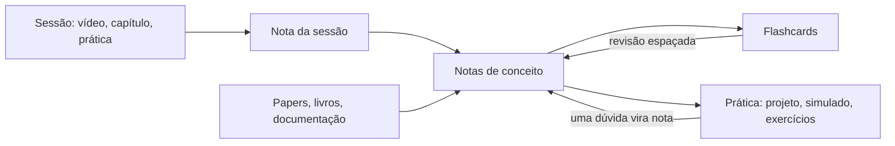
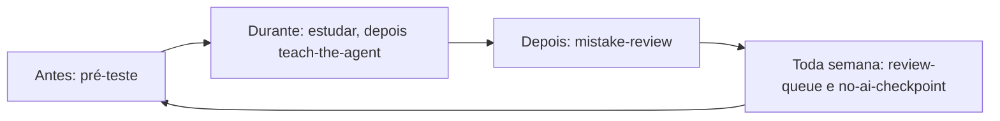
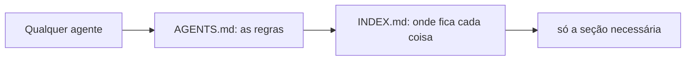

# Vault of Loci

[English](README.md) · **Português**

 

> O método de loci guarda memórias em lugares que você conhece. Este vault guarda o que você aprende em notas às quais você volta, com agentes de IA que perguntam em vez de responder por você.

Um modelo de vault do Obsidian para estudar qualquer coisa com agentes de IA: um curso, um livro, uma certificação, uma entrevista, uma pesquisa, uma habilidade ou um idioma. Cada projeto de aprendizado é uma trilha com uma meta, um critério de pronto e uma receita para o seu tipo. Toda nota é material de estudo (uma explicação longa, pontos para fixar e flashcards), toda fonte é conferida, e checagens automáticas mantêm notas, links e nomes consistentes. Claude Code, Codex, Antigravity CLI, Gemini CLI, Copilot, Cursor e OpenCode seguem as mesmas regras, de um único `AGENTS.md`.

Markdown puro. Licença MIT. As notas de exemplo e as regras para agentes estão em inglês; para estudar em português, troque os títulos da camada de estudo (veja Ferramentas).

## Por quê

- **Notas de onde dá para estudar**, não só um índice: cada conceito, paper e guia traz uma camada de estudo e os próprios flashcards.
- **Baseado em ciência do aprendizado**: prática de recuperação e revisão espaçada, com um protocolo de modo tutor para usar IA sem perder o aprendizado: você tenta primeiro, as pistas vêm em degraus, você dá sua confiança antes da resposta, e o agente nunca escreve a sua camada de estudo (veja `40_References/Guides/Studying_with_AI.md`).
- **Qualquer tipo de projeto de aprendizado**: uma receita por tipo (notas, prática, ritmo de revisão, checkpoint) em `90_System/Specs/Track_kinds.md`, mais rituais que toda trilha divide: planejar, fazer e refletir a cada sessão, prever a nota antes de um checkpoint, explicar sem notas, um limite diário de revisão com modo de recuperação, e sequências que perdoam dias perdidos.
- **Pronto para agentes**: um arquivo de regras, skills do projeto, um registro do que cada agente fez, um hook que formata toda nota que um agente escreve, e um índice gerado (`INDEX.md` e `90_System/index.json`) para o agente ler só a seção de que precisa.
- **Conferido a cada push**: formatação, links quebrados (inclusive links `obsidian://`, `README.md` e `llms.txt`), a camada de estudo, nomes de arquivo, flashcards (link de fonte em cada cartão, nenhuma pergunta repetida), arquivos de skill, o índice de leitura e testes.

## Como o material circula

## Começo rápido

1. Clique em **Use this template** no GitHub (ou clone) e abra a pasta como vault no Obsidian. É preciso o Obsidian 1.9 ou mais novo para as Bases. As skills opcionais de CLI (`review-queue`) pedem 1.12.7 ou mais novo, com o app aberto.
2. Opcional: instale o plugin da comunidade Spaced Repetition (listado em `.obsidian/community-plugins.json`) para revisar os flashcards. O vault não precisa de nenhum outro plugin.
3. Leia `How_to_Study_with_this_Vault.md` e depois `00_Home.md`.
4. Crie sua primeira trilha com a skill `new-track` no Claude Code ou no Codex (ela pergunta o tipo e o horizonte), ou copie `90_System/Templates/Track.md` para `10_Tracks/<NN>_<Name>/`.
5. Apague ou mantenha as trilhas, o conceito e o paper de exemplo. Eles mostram o formato completo das notas.
6. Rode `python3 -I 90_System/Scripts/run_checks.py`. Todas as checagens devem passar antes da sua primeira nota.

## Estrutura

| Caminho | Conteúdo |
|---|---|
| `00_Home.md` | Painel: trilhas, revisão do dia, bases |
| `00_Inbox/` | Capturas rápidas, esvaziadas na revisão semanal |
| `10_Tracks/` | Uma pasta por projeto de aprendizado: nota da trilha, `sessions/`, `practice/` |
| `20_Concepts/` | Uma nota por conceito, compartilhada entre trilhas |
| `30_Maps/` | Canvas, um por trilha, desenhados por `build_canvas.py` a partir das sessões e dos conceitos que elas ligam |
| `40_References/` | `Papers/`, `Books/`, `Repositories/`, `Web/`, `Guides/` (só fontes conferidas) |
| `50_Review/` | Baralhos de flashcards, glossários e `Mistakes.md` (o registro de erros, com o papel da IA em cada erro) |
| `90_System/` | `Templates/` (inclusive `Checkpoint.md`, `Debrief.md` e um kit de prática por tipo em `Practice/`), `Bases/` (inclusive `Tracks.base`, `Weakest.base`, `Interleave.base`, `Blueprint.base` e `Progress.base`), `Specs/` (inclusive `Track_kinds.md` e as traduções da camada de estudo), `Evals/` (um teste manual do modo tutor), `Scripts/`, `Agent_Log/`, `index.json` |
| `INDEX.md` | Índice de leitura gerado para agentes: uma linha por nota |

## Ferramentas

Scripts em Python, só com a biblioteca padrão, em `90_System/Scripts/`. Cada um tem teste. Comandos e opções estão em [`90_System/Specs/Tools.md`](90_System/Specs/Tools.md).

| Para | Script |
|---|---|
| Rodar todas as checagens | `run_checks.py` |
| Corrigir nomes de arquivo com espaço | `normalize_names.py` |
| Transformar legendas numa nota de transcrição lida por seção | `vtt_to_note.py`, `transcript_sections.py` |
| Desenhar um canvas por trilha | `build_canvas.py` |
| Revisar os cartões no Anki | `export_anki_tsv.py` |
| Citar as referências no Zotero, Pandoc ou LaTeX | `export_bibtex.py` |

Idioma, tipos de trilha, categorias de conceito, pastas e regras dos agentes podem ser mudados; [`Tools.md`](90_System/Specs/Tools.md#customize) diz onde. Para os títulos da camada de estudo em português, copie `90_System/Specs/study_layer.pt-BR.json` sobre `study_layer.json`.

## Estudar com um agente de IA

O agente é um tutor, não uma máquina de respostas. Você tenta primeiro, ele dá pistas um degrau por vez, você dá sua confiança antes de ele revelar qualquer coisa, e ele nunca escreve suas notas nem suas respostas. Praticar com IA sem proteção aumenta a nota enquanto você tem a IA e diminui quando ela some; um tutor com proteção evita boa parte disso (veja `40_References/Guides/Studying_with_AI.md`).

Uma sessão de estudo, com o que pedir:

| Quando | Peça ao agente | Skill |
|---|---|---|
| Ao começar algo novo | "Start a track for the book *X*, finishing in March" | `new-track` |
| Antes de uma sessão | "Pretest me on session 3" | `pretest` |
| Depois de ler | "I'll explain retrieval practice; list only my gaps" | `teach-the-agent` |
| Depois de um quiz | "Turn today's mistakes into cards" | `mistake-review` |
| Qualquer dia | "What should I review today?" | `review-queue` |
| Antes de uma entrevista, prova oral ou conversa | "Run a 30-minute observed mock" | `spoken-mock` |
| A cada duas semanas | "Closed-book checkpoint on what I studied before the 1st" | `no-ai-checkpoint` |
| Ao montar material | "Add a concept note on spacing", "process this paper", "save this page" | `new-concept-note`, `process-paper`, `process-web` |
| Antes do commit | "Run the checks" | `run-checks` |

Os pedidos estão em inglês porque as skills e as regras estão em inglês; o agente entende o pedido em português também.

As skills que gravam arquivos só rodam quando você pede. O Claude Code e o Cursor garantem isso com `disable-model-invocation` em cada skill, e o Codex com `agents/openai.yaml` (`allow_implicit_invocation: false`). Os outros agentes seguem a descrição da skill, que pede isso. Os agentes também têm as skills do Obsidian listadas em Créditos (`obsidian-markdown`, `obsidian-bases`, `json-canvas`, `obsidian-cli`, `defuddle`) para escrever Markdown, bases e canvas corretamente.

### Agentes suportados

Todo agente chega ao `AGENTS.md`, depois ao `INDEX.md`, depois só à seção de que precisa:

Onde cada agente procura seus arquivos. Um traço quer dizer que o vault não usa aquele arquivo; não diz nada sobre o agente.

| Agente | Arquivo de regras | Skills | Hooks | Config de MCP | Ignorar e permissões |
|---|---|---|---|---|---|
| Claude Code | `CLAUDE.md`, que importa `@AGENTS.md` | `.claude/skills` | `.claude/settings.json` | `.mcp.json` | `permissions.deny` e o sandbox |
| Codex | `AGENTS.md` | `.agents/skills` | `.codex/hooks.json` (projetos confiáveis) | `.codex/config.toml` | `sandbox_mode` e regras de negar leitura |
| Antigravity CLI (`agy`) | `GEMINI.md` e `AGENTS.md` | `.agents/skills` | - | `.agents/mcp_config.json` | não documentado |
| Gemini CLI | `GEMINI.md`, com importações `@` | `.gemini/skills` ou `.agents/skills` | - | `.gemini/settings.json` | `.geminiignore` |
| GitHub Copilot | `AGENTS.md`; `.github/copilot-instructions.md` é a alternativa | `.github/skills`, `.claude/skills` ou `.agents/skills`, conforme a interface | - | `.vscode/mcp.json` | exclusão de conteúdo nas configurações do GitHub |
| Cursor | `AGENTS.md` | `.agents/skills` | - | - | `.cursorignore` (o terminal e as ferramentas MCP passam por cima) |
| OpenCode | `AGENTS.md` | `.agents/skills` | - | - | - |

- O Claude Code só lê o `AGENTS.md` sozinho quando não existe `CLAUDE.md`, e ignora `.agents/`. Por isso o `CLAUDE.md` importa o `AGENTS.md` e `.claude/skills/` aponta para as pastas de `.agents/skills/`.
- Desde 2026-06-18, o Gemini CLI só está disponível com licenças empresariais e chaves de API pagas.
- O vault traz os arquivos de regras, as skills, `.claude/settings.json`, `.cursorignore` e `.geminiignore`. Os caminhos de MCP e de hooks na tabela são onde cada agente procura se você acrescentar os seus.
- Para conferir se um agente carregou as regras, pergunte qual arquivo de regras ele leu e o que modo tutor quer dizer aqui.

| Arquivo | Para que serve |
|---|---|
| `AGENTS.md` | O único arquivo de regras: como ler o vault, regras de escrita, modo tutor, segurança, fluxo de trabalho |
| `CLAUDE.md`, `GEMINI.md`, `.github/copilot-instructions.md` | Apontam o agente para o `AGENTS.md`, nada mais |
| `INDEX.md`, `90_System/index.json` | Mapa gerado: uma linha por nota, e cada título com o número da linha, para o agente abrir só a seção de que precisa |
| `llms.txt` | Índice opcional que segue a convenção llms.txt; nenhum agente grande o lê sozinho, então cole ou aponte quando uma ferramenta precisar de um mapa curto |
| `.agents/skills/` | As skills acima; `.claude/skills/` aponta para as mesmas pastas |
| `.claude/settings.json` | Só no Claude Code: nega leitura de `.env` e dos `data.json` de plugins, pede sua confirmação antes de qualquer edição nas suas notas (`10_Tracks/`, `20_Concepts/`, `50_Review/`), formata toda nota que um agente edita e refaz o índice. Os outros agentes contam com a regra do `AGENTS.md` e com `run-checks` |
| `.cursorignore`, `.geminiignore` | Tiram arquivos `.env` e `data.json` de plugins do contexto do Cursor e do Gemini CLI. Um comando de terminal ou uma ferramenta ainda consegue lê-los, então reduzem o risco mas não o eliminam |

Os agentes enviam as notas que leem ao seu provedor. Deixe material privado fora de um vault aberto com agente na nuvem, ou use um modelo local (veja `FAQ.md`).

## Contribuir

Conteúdo é bem-vindo, e não é preciso programar: notas de conceito, referências conferidas, guias, receitas de trilha, trilhas de exemplo, traduções e skills ajudam. Comece pelo formulário "Content proposal" ou por uma [good first issue](https://github.com/erikunha/vault-of-loci/labels/good%20first%20issue). O [`CONTRIBUTING.md`](CONTRIBUTING.md) diz o que cabe e mostra uma primeira contribuição feita toda pelo editor do GitHub no navegador. Contribuições são em inglês.

## Comunidade

- [`SUPPORT.md`](SUPPORT.md) e [Discussions](https://github.com/erikunha/vault-of-loci/discussions): perguntas, ideias e o que você construiu com o vault. Pode perguntar em português.
- [`FAQ.md`](FAQ.md): perguntas comuns sobre instalação, atualizar sua cópia, privacidade, uso offline, plugins, idioma e agentes.
- [`CHANGELOG.md`](CHANGELOG.md): o que mudou em cada versão.
- [`CODE_OF_CONDUCT.md`](CODE_OF_CONDUCT.md) e [`SECURITY.md`](SECURITY.md).
- O mantenedor é [@erikunha](https://github.com/erikunha).

## Contribuidores

Toda ajuda conta, não só código: conteúdo, tradução, revisão, ideias, relato de bug. Quem faz commit entra sozinho; para o resto, abra uma issue ou discussão e você entra à mão no `.all-contributorsrc`. Cada emoji é um tipo de contribuição ([legenda](https://allcontributors.org/docs/en/emoji-key)).

<!-- ALL-CONTRIBUTORS-LIST:START - Do not remove or modify this section -->
<!-- prettier-ignore-start -->
<!-- markdownlint-disable -->
<table>
  <tbody>
    <tr>
      <td align="center" valign="top" width="14.29%"><a href="https://erikunha.dev"> <b>Erik Cunha</b></a> <a href="https://github.com/erikunha/vault-of-loci/commits?author=erikunha" title="Maintenance">🚧</a> <a href="https://github.com/erikunha/vault-of-loci/commits?author=erikunha" title="Code">💻</a> <a href="https://github.com/erikunha/vault-of-loci/commits?author=erikunha" title="Content">🖋</a> <a href="https://github.com/erikunha/vault-of-loci/commits?author=erikunha" title="Documentation">📖</a> <a href="https://github.com/erikunha/vault-of-loci/commits?author=erikunha" title="Research">🔬</a> <a href="https://github.com/erikunha/vault-of-loci/commits?author=erikunha" title="Translation">🌍</a> <a href="https://github.com/erikunha/vault-of-loci/commits?author=erikunha" title="Tests">⚠️</a> <a href="https://github.com/erikunha/vault-of-loci/commits?author=erikunha" title="Infrastructure">🚇</a> <a href="https://github.com/erikunha/vault-of-loci/issues?q=author%3Aerikunha" title="Ideas, Planning, &amp; Feedback">🤔</a></td>
    </tr>
  </tbody>
</table>

<!-- markdownlint-restore -->
<!-- prettier-ignore-end -->

<!-- ALL-CONTRIBUTORS-LIST:END -->

## Créditos

- As skills de agente nas pastas marcadas com `.vendored` vêm de [kepano/obsidian-skills](https://github.com/kepano/obsidian-skills) (MIT, copyright Steph Ango). Cada pasta mantém sua `LICENSE`.

## Licença

MIT. Veja `LICENSE`.
